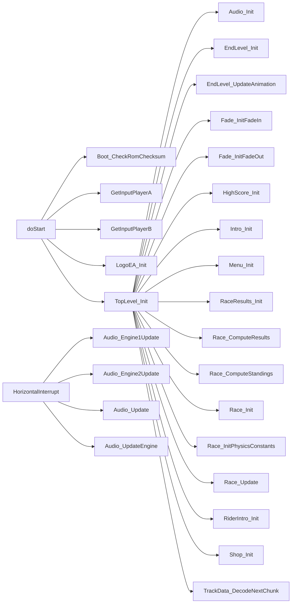

# Call graph (generated)

Generated by `tools/callgraph.py` from the `.asm` sources and
`build/roadrash.lst`. Best effort: `jsr`/`bsr`/`jmp` targets only;
indirect calls (e.g. `jsr (a0)`) are counted but not resolved.

**Usage:** this is a lookup table. `grep -n '<symbol>'` and read the matching row; do not
read the whole graph for a single-file pass.

## Summary

- Functions/symbols: **390**
- Resolved call edges: **695**
- Indirect calls seen: **9**

Notes: `VerticalInterrupt` calls the pointer stored in `ram_UpdateFunction`
and `FadeWithFunction_GameTick` calls `Fade_ram_UpdateFunction` indirectly;
those edges are not resolved here.

## Entry points / selected roots

## Function index

| Function | Address | Callers | Callees |
|---|---|---|---|
| `doStart` | `0x002FA` | - | `Boot_CheckRomChecksum`, `GetInputPlayerA`, `GetInputPlayerB`, `LogoEA_Init`, `TopLevel_Init` |
| `LogoEA_GameTick` | `0x00366` | - | `LogoEA_Update` |
| `LogoEA_AddSpritesVPos` | `0x0036C` | `LogoEA_Update` | - |
| `LogoEA_SetSpritesVerticalFlip` | `0x00382` | `LogoEA_Update` | - |
| `LogoEA_SetSquareSpritesHPos` | `0x00394` | `LogoEA_Update` | - |
| `LogoEA_SetTriangleSpritesHPos` | `0x003C0` | `LogoEA_Update` | - |
| `LogoEA_ShowSprites` | `0x003E2` | `LogoEA_Update` | - |
| `LogoEA_Update` | `0x00406` | `LogoEA_GameTick` | `LogoEA_AddSpritesVPos`, `LogoEA_ChangeTextColor`, `LogoEA_DrawCircle`, `LogoEA_SetSpritesVerticalFlip`, `LogoEA_SetSquareSpritesHPos`, `LogoEA_SetTriangleSpritesHPos`, `LogoEA_ShowSprites` |
| `LogoEA_CreateSprite` | `0x007BC` | `LogoEA_CreateFigureSprites` | - |
| `LogoEA_CreateFigureSprites` | `0x007E0` | `LogoEA_SetupGfx` | `LogoEA_CreateSprite` |
| `LogoEA_GetSquareLineMemOffset` | `0x00804` | `LogoEA_SetupGfx` | - |
| `LogoEA_GetPointOffsets` | `0x0080E` | `LogoEA_DrawLine` | - |
| `LogoEA_DrawLine` | `0x00824` | `LogoEA_DrawCircle`, `LogoEA_SetupGfx` | `LogoEA_GetPointOffsets` |
| `LogoEA_ChangeTextColor` | `0x0086C` | `LogoEA_Update` | - |
| `LogoEA_DrawCircle` | `0x0089A` | `LogoEA_Update` | `LogoEA_DrawLine` |
| `LogoEA_Init` | `0x0093E` | `doStart` | `LogoEA_SetupGfx` |
| `LogoEA_SetupGfx` | `0x00A08` | `LogoEA_Init` | `LogoEA_CreateFigureSprites`, `LogoEA_DecompressLZ`, `LogoEA_DrawLine`, `LogoEA_GetSquareLineMemOffset`, `LogoEA_WriteNametablePair` |
| `LogoEA_WriteNametablePair` | `0x00C32` | `LogoEA_SetupGfx` | - |
| `LogoEA_DecompressLZ` | `0x00C3C` | `LogoEA_SetupGfx` | - |
| `GetInputPlayerA` | `0x010D4` | `EndLevel_GameTick`, `EndLevel_GameTickVictoryCharacter`, `HighScore_GameTick`, `HighScore_GameTick_Demo`, `Intro_GameTick`, `MainMenu_GameTick`, `MenuPassword_GameTick`, `RaceResults_GameTick`, `Race_GetInput`, `Race_GetInputDemo`, `RiderIntro_GameTick`, `Shop_GameTick`, `doStart` | - |
| `GetInputPlayerB` | `0x0111C` | `EndLevel_GameTick`, `EndLevel_GameTickVictoryCharacter`, `HighScore_GameTick`, `HighScore_GameTick_Demo`, `Intro_GameTick`, `MainMenu_GameTick`, `MenuPassword_GameTick`, `RaceResults_GameTick`, `Race_GetInput`, `Race_GetInputDemo`, `RiderIntro_GameTick`, `Shop_GameTick`, `doStart` | - |
| `Fade_InitFadeOut` | `0x01180` | `TopLevel_Init` | - |
| `Fade_InitFadeIn` | `0x011C0` | `TopLevel_Init` | - |
| `Fade_GameTick` | `0x01242` | - | `DmaWriteCRAM` |
| `FadeWithFunction_GameTick` | `0x012F8` | - | `DmaWriteCRAM` |
| `HorizontalInterrupt` | `0x0145A` | - | `Audio_Engine1Update`, `Audio_Engine2Update`, `Audio_Update`, `Audio_UpdateEngine` |
| `Audio_UpdateEngine` | `0x01652` | `HorizontalInterrupt` | - |
| `Intro_Init` | `0x01704` | `TopLevel_Init` | `Audio_StartMusic`, `DmaWriteVRAM`, `EncodeString`, `Intro_InitPlayerA`, `Intro_InitPlayerB`, `Rand_InitSum`, `UncompressW`, `WriteNametable`, `WriteTilesetToVRAM`, `Rand_SeedLfsrs` |
| `Intro_InitPlayerA` | `0x01A2C` | `Intro_Init`, `Menu_Init` | - |
| `Intro_InitPlayerB` | `0x01B48` | `Intro_Init`, `Menu_Init` | - |
| `Intro_GameTick` | `0x01C64` | - | `Audio_StopMusic`, `Audio_Update`, `DmaWriteVRAM`, `EncodeString`, `GetInputPlayerA`, `GetInputPlayerB`, `WriteNametable` |
| `EncodeString` | `0x02288` | `DrawString`, `EndLevel_InitVictoryCharacter`, `HighScore_Init`, `Intro_GameTick`, `Intro_Init`, `MainMenu_HandleInput`, `MenuPassword_CreatePassword`, `MenuPassword_DrawNamesAndPasswords`, `MenuPassword_HandleInput`, `MenuPassword_ValidatePassword`, `Menu_DrawPlayerInfo`, `Menu_ShowMessage`, `RaceResults_DrawBusted`, `RaceResults_DrawRepair`, `RaceResults_DrawStandings`, `Race_DrawOpponentName`, `Race_DrawPlayerNameOrPlace`, `Race_LoadHUD`, `RiderIntro_Init`, `Shop_DrawBikeName`, `Shop_DrawString` | - |
| `DecodeString` | `0x022B2` | `MenuPassword_CreatePassword` | - |
| `WriteNametable` | `0x02402` | `EndLevel_Init`, `EndLevel_InitVictoryCharacter`, `HighScore_Init`, `Intro_GameTick`, `Intro_Init`, `Menu_Init`, `RaceResults_DrawBusted`, `RaceResults_DrawStandings`, `RaceResults_Init`, `Race_DrawTopHud`, `Race_LoadHUD`, `Race_LoadMoreTrackGfx`, `Race_LoatTrackGfx`, `RiderIntro_Init`, `Shop_DrawBikes`, `Shop_Init` | - |
| `MenuPassword_GameTick` | `0x024CC` | - | `Audio_Update`, `DmaWriteVRAM`, `GetInputPlayerA`, `GetInputPlayerB`, `MenuPassword_HandleInput`, `MenuPassword_SetCursorPos`, `MenuPassword_UpdateStatus`, `Menu_DrawPlayerInfo`, `Menu_DrawRaceSelection`, `Menu_ShowMessage` |
| `MenuPassword_HandleInput` | `0x02710` | `MenuPassword_GameTick` | `EncodeString`, `MenuPassword_DrawNamesAndPasswords`, `MenuPassword_SwapPlayerBlocks`, `MenuPassword_UpdateStatus`, `WriteNametableToBuffer` |
| `MenuPassword_UpdateStatus` | `0x02A1E` | `MenuPassword_GameTick`, `MenuPassword_HandleInput` | `MenuPassword_ParsePassword`, `MenuPassword_SelectCurrentTrack`, `MenuPassword_ValidatePassword` |
| `MenuPassword_SetCursorPos` | `0x02B18` | `MenuPassword_GameTick` | - |
| `MenuPassword_SelectCurrentTrack` | `0x02B2E` | `MainMenu_HandleInput`, `MenuPassword_UpdateStatus`, `Menu_Init` | - |
| `MenuPassword_SwapPlayerBlocks` | `0x02BEE` | `MenuPassword_HandleInput` | - |
| `MenuPassword_ValidatePassword` | `0x02C32` | `MenuPassword_CreatePassword`, `MenuPassword_UpdateStatus` | `EncodeString` |
| `MenuPassword_ParsePassword` | `0x02D1E` | `MenuPassword_UpdateStatus` | - |
| `MenuPassword_CreatePassword` | `0x02F3A` | `EndLevel_AdvanceLevel`, `Race_ComputeResults`, `Shop_HandleInput` | `DecodeString`, `EncodeString`, `MenuPassword_ValidatePassword` |
| `MenuPassword_DrawNamesAndPasswords` | `0x03306` | `MainMenu_HandleInput`, `MenuPassword_HandleInput` | `EncodeString`, `WriteNametableToBuffer` |
| `Menu_Init` | `0x03400` | `TopLevel_Init` | `Audio_StartMusic`, `DmaWriteVRAM`, `Intro_InitPlayerA`, `Intro_InitPlayerB`, `MenuPassword_SelectCurrentTrack`, `Menu_DrawPlayerInfo`, `Menu_DrawRaceSelection`, `Menu_ShowMessage`, `UncompressB`, `UncompressW`, `WriteNametable`, `WriteNametableToBuffer`, `WriteTilesetToVRAM` |
| `WriteNametableToBuffer` | `0x037AA` | `DrawString`, `EndLevel_Init`, `EndLevel_InitVictoryCharacter`, `HighScore_Init`, `MainMenu_HandleInput`, `MenuPassword_DrawNamesAndPasswords`, `MenuPassword_HandleInput`, `Menu_DrawPlayerInfo`, `Menu_DrawRaceSelection`, `Menu_Init`, `Menu_ShowMessage`, `Message_BlinkButtonC`, `Message_BlinkButtonStart`, `Message_Clear`, `Message_DrawButtonA`, `Message_DrawButtonB`, `Message_DrawDirPadVerticalIcon`, `Message_DrawDirPadHorizontalIcon`, `Message_ShowEmpty`, `RaceResults_DrawBusted`, `RaceResults_DrawRepair`, `RaceResults_DrawStandings`, `Race_DrawOpponentName`, `Race_DrawPlayerNameOrPlace`, `Race_LoadHUD`, `RiderIntro_Init`, `Shop_DrawBikeName`, `Shop_DrawString`, `Shop_Init` | - |
| `Menu_WriteNametableMasked` | `0x037D2` | `Menu_DrawRaceCard` | - |
| `MainMenu_GameTick` | `0x03802` | - | `Audio_StopMusic`, `Audio_Update`, `DmaWriteVRAM`, `GetInputPlayerA`, `GetInputPlayerB`, `MainMenu_HandleInput`, `Menu_ShowMessage`, `Rand_NextWord`, `Rand_StepLfsrAMod`, `Rand_StepLfsrB` |
| `Menu_DrawPlayerInfo` | `0x039AE` | `MainMenu_HandleInput`, `MenuPassword_GameTick`, `Menu_Init` | `EncodeString`, `UncompressW`, `WriteNametableToBuffer` |
| `Menu_BuildRaceTooltip` | `0x03B56` | `MainMenu_HandleInput` | - |
| `MainMenu_HandleInput` | `0x03BE2` | `MainMenu_GameTick` | `Audio_StartMusic`, `Audio_StopMusic`, `EncodeString`, `MenuPassword_DrawNamesAndPasswords`, `MenuPassword_SelectCurrentTrack`, `Menu_BuildRaceTooltip`, `Menu_DrawPlayerInfo`, `Menu_DrawRaceSelection`, `UncompressW`, `WriteNametableToBuffer` |
| `Menu_DrawRaceSelection` | `0x03F18` | `MainMenu_HandleInput`, `MenuPassword_GameTick`, `Menu_Init` | `Menu_DrawRaceCard`, `WriteNametableToBuffer` |
| `Menu_DrawRaceCard` | `0x0408E` | `Menu_DrawRaceSelection` | `Menu_WriteNametableMasked` |
| `Menu_ShowMessage` | `0x0417C` | `EndLevel_GameTickVictoryCharacter`, `HighScore_GameTick`, `MainMenu_GameTick`, `MenuPassword_GameTick`, `Menu_Init`, `RaceResults_GameTick`, `RiderIntro_GameTick`, `RiderIntro_Init`, `Shop_GameTick` | `EncodeString`, `Message_Clear`, `Message_ShowEmpty`, `WriteNametableToBuffer` |
| `Message_ShowEmpty` | `0x04226` | `Menu_ShowMessage` | `WriteNametableToBuffer` |
| `Message_ShowNoop` | `0x04268` | `Message_MsgArray` (function pointer) | - |
| `Message_Clear` | `0x0426A` | `Menu_ShowMessage`, `Message_BlinkButtonA`, `Message_BlinkButtonB`, `Message_BlinkButtonC`, `Message_BlinkButtonStart`, `Message_BlinkButtonsAB`, `Message_BlinkDirectionalPad`, `Message_BlinkDirPadVertical`, `Message_BlinkDirPadHorizontal` | `WriteNametableToBuffer` |
| `Message_BlinkButtonA` | `0x042AA` | - | `Message_Clear`, `Message_DrawButtonA` |
| `Message_DrawButtonA` | `0x042D0` | `Message_BlinkButtonA`, `Message_BlinkButtonsAB` | `WriteNametableToBuffer` |
| `Message_BlinkButtonB` | `0x04302` | - | `Message_Clear`, `Message_DrawButtonB` |
| `Message_DrawButtonB` | `0x0432A` | `Message_BlinkButtonB`, `Message_BlinkButtonsAB` | `WriteNametableToBuffer` |
| `Message_BlinkButtonsAB` | `0x04362` | - | `Message_Clear`, `Message_DrawButtonA`, `Message_DrawButtonB` |
| `Message_BlinkButtonC` | `0x04392` | - | `Message_Clear`, `WriteNametableToBuffer` |
| `Message_BlinkButtonStart` | `0x043F6` | - | `Message_Clear`, `WriteNametableToBuffer` |
| `Message_BlinkDirPadHorizontal` | `0x0445E` | - | `Message_Clear`, `Message_DrawDirPadHorizontalIcon` |
| `Message_DrawDirPadHorizontalIcon` | `0x04486` | `Message_BlinkDirPadHorizontal`, `Message_BlinkDirectionalPad` | `WriteNametableToBuffer` |
| `Message_BlinkDirPadVertical` | `0x044D6` | - | `Message_Clear`, `Message_DrawDirPadVerticalIcon` |
| `Message_DrawDirPadVerticalIcon` | `0x044FE` | `Message_BlinkDirPadVertical`, `Message_BlinkDirectionalPad` | `WriteNametableToBuffer` |
| `Message_BlinkDirectionalPad` | `0x0454E` | - | `Message_Clear`, `Message_DrawDirPadHorizontalIcon`, `Message_DrawDirPadVerticalIcon` |
| `RiderSprites_Build` | `0x05760` | `RiderSprites_BuildAlt`, `Road_DrawStrip` | - |
| `RiderSprites_BuildAlt` | `0x0593E` | - | `RiderSprites_Build` |
| `RiderIntro_Init` | `0x059C4` | `TopLevel_Init` | `DmaWriteVRAM`, `EncodeString`, `Menu_ShowMessage`, `Rand_NextWord`, `UncompressB`, `UncompressW`, `WriteNametable`, `WriteNametableToBuffer`, `WriteTilesetToVRAM` |
| `RiderIntro_GameTick` | `0x05E66` | - | `Audio_StopMusic`, `Audio_Update`, `DmaWriteVRAM`, `GetInputPlayerA`, `GetInputPlayerB`, `Menu_ShowMessage` |
| `RaceResults_Init` | `0x05F28` | `TopLevel_Init` | `Audio_StartMusic`, `Audio_StopMusic`, `DmaWriteVRAM`, `RaceResults_DrawBusted`, `RaceResults_DrawRepair`, `RaceResults_DrawStandings`, `Race_FormatMoney`, `UncompressB`, `UncompressW`, `WriteNametable`, `WriteTilesetToVRAM` |
| `RaceResults_DrawStandings` | `0x062CE` | `RaceResults_Init` | `EncodeString`, `UncompressW`, `WriteNametable`, `WriteNametableToBuffer`, `WriteTilesetToVRAM` |
| `RaceResults_DrawBusted` | `0x0647E` | `RaceResults_Init` | `EncodeString`, `Race_FormatNumber`, `Rand_NextWord`, `UncompressB`, `UncompressW`, `WriteNametable`, `WriteNametableToBuffer`, `WriteTilesetToVRAM` |
| `RaceResults_DrawRepair` | `0x067AC` | `RaceResults_Init` | `EncodeString`, `Race_FormatNumber`, `Rand_NextWord`, `UncompressB`, `UncompressW`, `WriteNametableToBuffer`, `WriteTilesetToVRAM` |
| `RaceResults_GameTick` | `0x06A90` | - | `Audio_StopMusic`, `Audio_Update`, `DmaWriteVRAM`, `GetInputPlayerA`, `GetInputPlayerB`, `Menu_ShowMessage`, `RaceResults_HandleInput` |
| `RaceResults_HandleInput` | `0x06BD4` | `RaceResults_GameTick` | - |
| `DrawString` | `0x06C5E` | - | `EncodeString`, `WriteNametableToBuffer` |
| `HighScore_Init` | `0x06DC0` | `TopLevel_Init` | `Audio_StartMusic`, `Audio_StopMusic`, `DmaWriteVRAM`, `EncodeString`, `UncompressB`, `UncompressW`, `WriteNametable`, `WriteNametableToBuffer`, `WriteTilesetToVRAM` |
| `HighScore_GameTick_Demo` | `0x072BA` | - | `Audio_StopMusic`, `Audio_Update`, `GetInputPlayerA`, `GetInputPlayerB` |
| `HighScore_GameTick` | `0x0732E` | - | `Audio_StopMusic`, `Audio_Update`, `DmaWriteVRAM`, `GetInputPlayerA`, `GetInputPlayerB`, `HighScore_HandleInput`, `Menu_ShowMessage` |
| `HighScore_HandleInput` | `0x07460` | `HighScore_GameTick` | - |
| `Shop_Init` | `0x074AA` | `TopLevel_Init` | `Audio_StartMusic`, `Audio_StopMusic`, `DmaWriteVRAM`, `Shop_DrawBikeName`, `Shop_DrawBikes`, `Shop_DrawCreditsAndPrice`, `Shop_PrepareMessages`, `Shop_ShowBikeDescription`, `UncompressB`, `UncompressW`, `WriteNametable`, `WriteNametableToBuffer`, `WriteTilesetToVRAM` |
| `Shop_DrawBikeName` | `0x07996` | `Shop_HandleInput`, `Shop_Init` | `EncodeString`, `WriteNametableToBuffer` |
| `Shop_ShowBikeDescription` | `0x079DA` | `Shop_HandleInput`, `Shop_Init` | - |
| `Shop_GameTick` | `0x079F8` | - | `Audio_StopMusic`, `Audio_Update`, `DmaWriteCRAM`, `DmaWriteVRAM`, `GetInputPlayerA`, `GetInputPlayerB`, `Menu_ShowMessage`, `Shop_HandleInput`, `Shop_UpdateScroll` |
| `Shop_HandleInput` | `0x07B4C` | `Shop_GameTick` | `MenuPassword_CreatePassword`, `Shop_DrawBikeName`, `Shop_DrawBikes`, `Shop_DrawCreditsAndPrice`, `Shop_PrepareMessages`, `Shop_ShowAlreadyOwned`, `Shop_ShowBikeDescription`, `Shop_ShowCannotAfford` |
| `Shop_DrawCreditsAndPrice` | `0x07D5E` | `Shop_HandleInput`, `Shop_Init` | `Race_FormatNumber`, `Shop_DrawString` |
| `Shop_DrawString` | `0x07E70` | `Shop_DrawCreditsAndPrice` | `EncodeString`, `WriteNametableToBuffer` |
| `Shop_ShowAlreadyOwned` | `0x07EA2` | `Shop_HandleInput` | - |
| `Shop_ShowCannotAfford` | `0x07F02` | `Shop_HandleInput` | - |
| `Shop_PrepareMessages` | `0x07F62` | `Shop_HandleInput`, `Shop_Init` | - |
| `Shop_DrawBikes` | `0x0803C` | `Shop_HandleInput`, `Shop_Init` | `WriteNametable` |
| `Shop_UpdateScroll` | `0x08178` | `Shop_GameTick` | - |
| `EndLevel_Init` | `0x08342` | `TopLevel_Init` | `Audio_StartMusic`, `Audio_StopMusic`, `DmaWriteVRAM`, `UncompressB`, `UncompressToVRAM`, `UncompressW`, `WriteNametable`, `WriteNametableToBuffer`, `WriteTilesetToVRAM` |
| `EndLevel_InitVictoryCharacter` | `0x08682` | `EndLevel_GameTick` | `DmaWriteCRAM`, `EncodeString`, `EndLevel_AdvanceLevel`, `Rand_NextWord`, `UncompressB`, `UncompressW`, `WriteNametable`, `WriteNametableToBuffer`, `WriteTilesetToVRAM` |
| `EndLevel_AdvanceLevel` | `0x08946` | `EndLevel_InitVictoryCharacter` | `MenuPassword_CreatePassword` |
| `EndLevel_GameTickVictoryCharacter` | `0x08A1A` | - | `Audio_StopMusic`, `Audio_Update`, `DmaWriteVRAM`, `GetInputPlayerA`, `GetInputPlayerB`, `Menu_ShowMessage` |
| `EndLevel_GameTick` | `0x08AEE` | - | `Audio_Update`, `DmaWriteVRAM`, `EndLevel_InitVictoryCharacter`, `GetInputPlayerA`, `GetInputPlayerB`, `Race_SwapFrames` |
| `EndLevel_UpdateAnimation` | `0x08B94` | `TopLevel_Init` | `Race_FinishFrame`, `UpdateAnimation2` |
| `Road_DrawStrip` | `0x08FB4` | `Road_DrawObject` | `RiderSprites_Build`, `Road_ClearEdgeTiles`, `Road_InterpolateLeftEdge`, `Road_InterpolateRightEdge`, `Road_WriteTileColumns` |
| `Road_InterpolateLeftEdge` | `0x09142` | `Road_DrawStrip` | - |
| `Road_InterpolateRightEdge` | `0x091F0` | `Road_DrawStrip` | - |
| `Road_WriteTileColumns` | `0x09306` | `Road_DrawStrip` | - |
| `Road_ClearEdgeTiles` | `0x093D2` | `Road_DrawStrip` | - |
| `Road_DrawObjects` | `0x0942A` | `Race_Update` | `Road_DrawObject` |
| `Road_DrawObject` | `0x09484` | `Road_DrawObjects` | `Road_DrawStrip`, `Road_ProjectShape`, `Road_ProjectShapeSpecial`, `Road_ScaleShape` |
| `Road_ScaleShape` | `0x0978C` | `Road_DrawObject` | - |
| `Road_ProjectShapeSpecial` | `0x097BC` | `Road_DrawObject` | - |
| `Road_ProjectShape` | `0x09836` | `Road_DrawObject` | - |
| `RaceHud_DrawStandings` | `0x098C2` | - | `RaceHud_WriteDigit2`, `RaceHud_WriteDigit4` |
| `RaceDebug_ShowDistanceTravelled` | `0x09936` | - | `RaceHud_WriteDigit4`, `Race_FormatDecimal` |
| `RaceDebug_ShowPosZ` | `0x0995A` | - | `RaceHud_WriteDigit4`, `Race_FormatDecimal` |
| `RaceDebug_ShowFrameDelay` | `0x0997E` | - | `RaceHud_WriteDigit4`, `Race_FormatDecimal` |
| `sub_999E` | `0x0999E` | - | `RaceHud_WriteDigit2`, `Race_FormatDecimal` |
| `RaceDebug_ShowState` | `0x099C2` | - | `RaceHud_WriteDigit4` |
| `sub_9A98` | `0x09A98` | - | `RaceHud_WriteDigit4` |
| `RaceHud_DrawGear` | `0x09AB4` | - | `RaceHud_WriteDigit1` |
| `RaceHud_WriteDigit1` | `0x09AD4` | `RaceHud_DrawGear` | - |
| `RaceHud_WriteDigit2` | `0x09AF4` | `RaceHud_DrawStandings`, `sub_999E` | - |
| `RaceHud_WriteDigit4` | `0x09B34` | `RaceDebug_ShowDistanceTravelled`, `RaceDebug_ShowFrameDelay`, `RaceDebug_ShowPosZ`, `RaceDebug_ShowState`, `RaceHud_DrawStandings`, `sub_9A98` | - |
| `UncompressB` | `0x09B9E` | `EndLevel_Init`, `EndLevel_InitVictoryCharacter`, `HighScore_Init`, `Menu_Init`, `RaceResults_DrawBusted`, `RaceResults_DrawRepair`, `RaceResults_Init`, `Race_LoatTrackGfx`, `RiderIntro_Init`, `Shop_Init` | - |
| `UncompressW` | `0x09C26` | `EndLevel_Init`, `EndLevel_InitVictoryCharacter`, `HighScore_Init`, `Intro_Init`, `MainMenu_HandleInput`, `Menu_DrawPlayerInfo`, `Menu_Init`, `RaceResults_DrawBusted`, `RaceResults_DrawRepair`, `RaceResults_DrawStandings`, `RaceResults_Init`, `Race_DrawTopHud`, `Race_LoadFonts`, `Race_LoadHUD`, `Race_LoadMoreTrackGfx`, `Race_LoadRoadImage`, `RiderIntro_Init`, `Shop_Init` | - |
| `UncompressToVRAM` | `0x09EF8` | `EndLevel_Init` | - |
| `TrackData_StartDecode` | `0x09FE4` | `TrackData_InitLevel` | `TrackData_DecodeChunk` |
| `TrackData_DecodeChunk` | `0x0A04A` | `TrackData_DecodeNextChunk`, `TrackData_StartDecode` | `TrackData_DecodeChannel1`, `TrackData_DecodeChannel2` |
| `TrackData_DecodeChannel1` | `0x0A0D4` | `TrackData_DecodeChunk` | - |
| `TrackData_DecodeChannel2` | `0x0A2DA` | `TrackData_DecodeChunk` | - |
| `Race_Init` | `0x0A4E2` | `TopLevel_Init` | `Race_ClearFrameBuffers`, `Race_ClearHudCorners`, `Race_CreateActors`, `Race_DrawTopHud`, `Race_GameTick`, `Race_InitActorLists`, `Race_InitActorPositions`, `Race_InitAudio`, `Race_InitTrack`, `Race_InitVariables`, `Race_InitVdp`, `Race_LoadBikeData`, `Race_LoadBikePalette`, `Race_LoadFonts`, `Race_LoadHUD`, `Race_LoadMoreTrackGfx`, `Race_LoadRoadImage`, `Race_LoadTrackParams`, `Race_LoatTrackGfx`, `Race_SpawnOpponents`, `Race_Update`, `TrackData_InitLevel` |
| `Race_InitAudio` | `0x0A674` | `Race_Init` | `Audio_Engine1Start`, `Audio_Engine1Update`, `Audio_Engine2Start`, `Audio_Engine2Update`, `Audio_Engine3Start`, `Audio_Engine3Update`, `Audio_StartMusic` |
| `Race_InitVdp` | `0x0A72A` | `Race_Init` | - |
| `Race_DrawTopHud` | `0x0A79C` | `Race_Init` | `UncompressW`, `WriteNametable`, `WriteTilesetToVRAM` |
| `Race_LoatTrackGfx` | `0x0A90A` | `Race_Init` | `UncompressB`, `WriteNametable`, `WriteTilesetToVRAM` |
| `Race_LoadMoreTrackGfx` | `0x0A9DE` | `Race_Init` | `UncompressW`, `WriteNametable`, `WriteTilesetToVRAM` |
| `Race_ClearFrameBuffers` | `0x0AB38` | `Race_Init` | `Race_FillHudTile` |
| `Race_ClearHudCorners` | `0x0AB78` | `Race_Init` | - |
| `Race_FillHudTile` | `0x0AB9A` | `Race_ClearFrameBuffers` | - |
| `Race_LoadHUD` | `0x0ABBA` | `Race_Init` | `EncodeString`, `UncompressW`, `WriteNametable`, `WriteNametableToBuffer`, `WriteTilesetToVRAM` |
| `Race_LoadRoadImage` | `0x0ADFC` | `Race_Init` | `Race_DrawRearviewMirror`, `UncompressW`, `WriteTilesetToVRAM` |
| `Race_LoadFonts` | `0x0AF40` | `Race_Init` | `UncompressW`, `WriteTilesetToVRAM` |
| `WriteTilesetToVRAM` | `0x0AFF2` | `EndLevel_Init`, `EndLevel_InitVictoryCharacter`, `HighScore_Init`, `Intro_Init`, `Menu_Init`, `RaceResults_DrawBusted`, `RaceResults_DrawRepair`, `RaceResults_DrawStandings`, `RaceResults_Init`, `Race_DrawTopHud`, `Race_LoadFonts`, `Race_LoadHUD`, `Race_LoadMoreTrackGfx`, `Race_LoadRoadImage`, `Race_LoatTrackGfx`, `RiderIntro_Init`, `Shop_Init` | - |
| `Race_InitTrack` | `0x0B016` | `Race_Init` | - |
| `Race_InitVariables` | `0x0B0E8` | `Race_Init` | - |
| `Race_InitActorLists` | `0x0B6C4` | `Race_Init` | - |
| `Race_InitActorPositions` | `0x0B72A` | `Race_Init` | - |
| `Race_InitPhysicsConstants` | `0x0B770` | `TopLevel_Init` | - |
| `Race_LoadTrackParams` | `0x0B840` | `Race_Init` | - |
| `Race_LoadBikeData` | `0x0B86A` | `Race_Init` | - |
| `Race_SpawnOpponents` | `0x0B8D0` | `Race_Init` | `Rand_NextWord` |
| `Race_ResetFrameTimers` | `0x0B9AE` | `Race_GameTick` | - |
| `Race_UpdateTime` | `0x0BA02` | `Race_GameTick` | - |
| `Race_GameTick` | `0x0BA76` | `Race_Init` | `Audio_Engine1Stop`, `Audio_Engine2Stop`, `Audio_Engine3Stop`, `DmaWriteCRAM`, `DmaWriteVRAM`, `Race_GetInput`, `Race_GetInputDemo`, `Race_ResetFrameTimers`, `Race_SwapFrames`, `Race_UpdateTime`, `Race_WriteSpriteTiles` |
| `Race_SwapFrames` | `0x0BBFE` | `EndLevel_GameTick`, `Race_GameTick` | - |
| `Race_FinishFrame` | `0x0BD24` | `EndLevel_UpdateAnimation`, `Race_Update` | - |
| `Race_GetInputDemo` | `0x0BE2C` | `Race_GameTick` | `GetInputPlayerA`, `GetInputPlayerB` |
| `Race_GetInput` | `0x0BE56` | `Race_GameTick` | `Audio_Resume`, `Audio_StopMusic`, `GetInputPlayerA`, `GetInputPlayerB` |
| `Race_Update` | `0x0C00C` | `Race_Init`, `TopLevel_Init` | `PiecewiseLinearInterpolation`, `RaceHud_Draw`, `Race_AddSpecialObject`, `Race_AddStagedObjects`, `Race_AddTrackStartObject`, `Race_BuildActorObjectList`, `Race_BuildHScrollTable`, `Race_BuildTrackObjects`, `Race_BuildVScrollInfo`, `Race_ClearActorOnFootFlags`, `Race_DrawRearviewMirror`, `Race_DrawRoadEdges`, `Race_DrawRoadMarkingHud`, `Race_FinishFrame`, `Race_InitExtraStaticActor`, `Race_IntegrateTrackCurve`, `Race_SpawnTick`, `Race_UpdateActorAI`, `Race_UpdateActorActions`, `Race_UpdateActorSpeedState`, `Race_UpdateBikeLean`, `Race_UpdateCamera`, `Race_UpdateExtraStaticActor`, `Race_UpdateNearestOpponent`, `Race_UpdateNearestTarget`, `Race_UpdatePlayerAnimation`, `Race_UpdateSpeedDisplay`, `Race_UpdateStaticActions`, `Race_UpdateStaticActors`, `RoadMarking_Draw`, `Road_BuildVisibleList`, `Road_DrawObjects`, `Road_FillProfileTables`, `sub_10DBE`, `sub_10DDA`, `sub_11C44`, `sub_11CC8`, `sub_1218C`, `sub_123A8`, `sub_1383E`, `sub_138CE`, `sub_13BF4`, `sub_13E94`, `sub_14E38` |
| `Race_SortResults` | `0x0C378` | `Race_ComputeResults` | - |
| `Race_ComputeResults` | `0x0C3F8` | `TopLevel_Init` | `MenuPassword_CreatePassword`, `Race_BuildStandings`, `Race_SortResults`, `Race_UpdateHighScoreTable` |
| `Race_UpdateHighScoreTable` | `0x0C598` | `Race_ComputeResults` | `Race_FormatMoney` |
| `Race_FormatMoney` | `0x0C6C4` | `RaceResults_Init`, `Race_UpdateHighScoreTable` | - |
| `Race_FormatNumber` | `0x0C79A` | `RaceResults_DrawBusted`, `RaceResults_DrawRepair`, `Race_BuildStandings`, `Shop_DrawCreditsAndPrice` | - |
| `Race_BuildStandings` | `0x0C868` | `Race_ComputeResults` | `Race_FormatNumber`, `Race_FormatTime` |
| `Race_FormatTime` | `0x0C9D4` | `Race_BuildStandings` | - |
| `Race_LoadBikePalette` | `0x0CA50` | `Race_Init` | - |
| `Race_LoadActorPalette` | `0x0CAAE` | `Race_CreateActors` | - |
| `Race_CreateActors` | `0x0CAD0` | `Race_Init` | `Race_LoadActorPalette` |
| `RaceHud_Draw` | `0x0D278` | `Race_Update` | `RaceHud_DrawOdometer`, `RaceHud_DrawPlace`, `RaceHud_DrawRPMArrow`, `RaceHud_DrawSpeedArrow`, `RaceHud_DrawStamina`, `RaceHud_DrawTime`, `Race_DrawBikeHPBar`, `Race_DrawOpponentName`, `Race_DrawPlayerNameOrPlace` |
| `RaceHud_DrawSpeedArrow` | `0x0D29E` | `RaceHud_Draw` | `UpdateAnimation` |
| `RaceHud_DrawRPMArrow` | `0x0D2DC` | `RaceHud_Draw` | `UpdateAnimation` |
| `RaceHud_DrawOdometer` | `0x0D334` | `RaceHud_Draw` | - |
| `RaceHud_DrawPlace` | `0x0D3F6` | `RaceHud_Draw` | `RaceHud_DrawNumber2Digits` |
| `RaceHud_DrawTime` | `0x0D410` | `RaceHud_Draw` | `RaceHud_DrawNumber2Digits`, `RaceHud_DrawSymbol` |
| `RaceHud_DrawStamina` | `0x0D458` | `RaceHud_Draw` | - |
| `Race_DrawBikeHPBar` | `0x0D534` | `RaceHud_Draw` | - |
| `Race_DrawPlayerNameOrPlace` | `0x0D5CE` | `RaceHud_Draw` | `EncodeString`, `WriteNametableToBuffer` |
| `Race_DrawOpponentName` | `0x0D73A` | `RaceHud_Draw` | `EncodeString`, `WriteNametableToBuffer` |
| `RaceHud_DrawSymbol` | `0x0D830` | `RaceHud_DrawTime` | - |
| `RaceHud_DrawNumber2Digits` | `0x0D850` | `RaceHud_DrawPlace`, `RaceHud_DrawTime` | - |
| `DmaWriteVRAM` | `0x0D8FA` | `EndLevel_GameTick`, `EndLevel_GameTickVictoryCharacter`, `EndLevel_Init`, `HighScore_GameTick`, `HighScore_Init`, `Intro_GameTick`, `Intro_Init`, `MainMenu_GameTick`, `MenuPassword_GameTick`, `Menu_Init`, `RaceResults_GameTick`, `RaceResults_Init`, `Race_GameTick`, `Race_WriteSpriteTiles`, `RiderIntro_GameTick`, `RiderIntro_Init`, `Shop_GameTick`, `Shop_Init` | - |
| `DmaWriteCRAM` | `0x0D96A` | `EndLevel_InitVictoryCharacter`, `FadeWithFunction_GameTick`, `Fade_GameTick`, `Race_GameTick`, `Shop_GameTick` | - |
| `Race_DrawRearviewMirror` | `0x0D9DA` | `Race_LoadRoadImage`, `Race_Update` | `Race_DrawMirrorRoad` |
| `Race_DrawMirrorRoad` | `0x0DA3E` | `Race_DrawRearviewMirror` | - |
| `Race_ProjectActorSprite` | `0x0DAE2` | `Race_BuildActorObjectList` | `Race_GetActorShapeVariant` |
| `Race_DrawRoadMarkingHud` | `0x0DD84` | `Race_Update` | - |
| `Race_UpdateCamera` | `0x0DE9E` | `Race_Update` | - |
| `Race_BuildVScrollInfo` | `0x0E004` | `Race_Update` | - |
| `Race_BuildHScrollTable` | `0x0E494` | `Race_Update` | - |
| `Race_UpdateNearestOpponent` | `0x0E5EE` | `Race_Update` | - |
| `RoadMarking_Draw` | `0x0E75E` | `Race_Update` | `RoadMarking_ClearSpriteTiles`, `RoadMarking_CreateSprite`, `RoadMarking_FindUnprocessedLine`, `RoadMarking_GetMarkingsSizes`, `RoadMarking_SetSpriteGeometry` |
| `RoadMarking_FindUnprocessedLine` | `0x0E7B0` | `RoadMarking_Draw` | - |
| `RoadMarking_GetMarkingsSizes` | `0x0E7DA` | `RoadMarking_Draw` | - |
| `RoadMarking_SetSpriteGeometry` | `0x0E934` | `RoadMarking_Draw` | - |
| `RoadMarking_ClearSpriteTiles` | `0x0E9D2` | `RoadMarking_Draw` | - |
| `RoadMarking_CreateSprite` | `0x0E9F8` | `RoadMarking_Draw` | - |
| `Race_DrawRoadEdges` | `0x0EC90` | `Race_Update` | - |
| `Road_FillProfileTables` | `0x0ECE0` | `Race_Update` | - |
| `Race_IntegrateTrackCurve` | `0x0EDD0` | `Race_Update` | - |
| `Race_ComputeStandings` | `0x0EFA4` | `TopLevel_Init` | `Race_ScaleResultValue`, `Rand_NextWord` |
| `Race_ScaleResultValue` | `0x0F0E4` | `Race_ComputeStandings` | - |
| `Race_UpdateSpeedDisplay` | `0x0F108` | `Race_Update` | `Race_FormatDecimal` |
| `Race_FormatDecimal` | `0x0F11C` | `RaceDebug_ShowDistanceTravelled`, `RaceDebug_ShowFrameDelay`, `RaceDebug_ShowPosZ`, `Race_UpdateSpeedDisplay`, `sub_999E` | - |
| `PiecewiseLinearInterpolation` | `0x0F180` | `Race_Update` | `FillLinearInterpArray` |
| `FillLinearInterpArray` | `0x0F1AE` | `PiecewiseLinearInterpolation` | - |
| `Race_BuildActorObjectList` | `0x0F40C` | `Race_Update` | `Race_AddActorFallObject`, `Race_AddActorImpactObject`, `Race_AddActorLeanObject`, `Race_AddActorWeaponObject`, `Race_ProjectActorObject`, `Race_ProjectActorSprite`, `Race_ProjectObject`, `Race_SelectActorObjectShape`, `Race_SelectExtraActorShape`, `Race_SelectOpponentShape`, `Race_SelectPlayerFinishShape`, `sub_15014` |
| `Race_AddActorLeanObject` | `0x0F842` | `Race_BuildActorObjectList` | `Race_ProjectObject` |
| `Race_AddActorImpactObject` | `0x0F90E` | `Race_BuildActorObjectList` | `Race_ProjectObject` |
| `Race_AddActorFallObject` | `0x0F9C4` | `Race_BuildActorObjectList` | `Race_ProjectObject` |
| `Race_AddActorWeaponObject` | `0x0FA98` | `Race_BuildActorObjectList` | `Race_ProjectObject` |
| `Race_AddTrackStartObject` | `0x0FB1E` | `Race_Update` | `Race_ProjectObject`, `sub_15478` |
| `Race_AddStagedObjects` | `0x0FC0E` | `Race_Update` | `Race_ProjectObject` |
| `Race_AddSpecialObject` | `0x0FD96` | `Race_Update` | - |
| `Race_ProjectObject` | `0x0FE3A` | `Race_AddActorFallObject`, `Race_AddActorImpactObject`, `Race_AddActorLeanObject`, `Race_AddActorWeaponObject`, `Race_AddStagedObjects`, `Race_AddTrackStartObject`, `Race_BuildActorObjectList` | - |
| `Race_ProjectActorObject` | `0x0FF7E` | `Race_BuildActorObjectList` | - |
| `Race_SelectActorObjectShape` | `0x100D0` | `Race_BuildActorObjectList`, `sub_1030A`, `sub_10384` | `Race_SelectActorIdleShape`, `Race_SelectActorSpeedShape`, `sub_1030A`, `sub_1081A` |
| `Race_SelectActorSpeedShape` | `0x101EA` | `Race_SelectActorObjectShape` | - |
| `Race_SelectActorIdleShape` | `0x1022E` | `Race_SelectActorObjectShape` | - |
| `Race_SelectOpponentShape` | `0x10256` | `Race_BuildActorObjectList` | - |
| `Race_SelectPlayerFinishShape` | `0x10294` | `Race_BuildActorObjectList` | - |
| `Race_GetActorShapeVariant` | `0x102E4` | `Race_ProjectActorSprite` | - |
| `sub_1030A` | `0x1030A` | `Race_SelectActorObjectShape` | `Race_SelectActorObjectShape`, `sub_10384`, `sub_10762` |
| `sub_10384` | `0x10384` | `sub_1030A` | `Race_SelectActorObjectShape`, `sub_104E6` |
| `sub_104E6` | `0x104E6` | `sub_10384` | - |
| `sub_10762` | `0x10762` | `sub_1030A` | - |
| `sub_1081A` | `0x1081A` | `Race_SelectActorObjectShape` | - |
| `Race_SelectExtraActorShape` | `0x108DA` | `Race_BuildActorObjectList` | - |
| `Race_WriteSpriteTiles` | `0x10972` | `Race_GameTick` | `DmaWriteVRAM` |
| `Race_BuildTrackObjects` | `0x109B6` | `Race_Update` | `Race_ProjectTrackObject` |
| `Race_ProjectTrackObject` | `0x10C4E` | `Race_BuildTrackObjects` | - |
| `Road_BuildVisibleList` | `0x10D46` | `Race_Update` | - |
| `sub_10DBE` | `0x10DBE` | `Race_Update` | `sub_10E00` |
| `sub_10DDA` | `0x10DDA` | `Race_Update` | `sub_10E00` |
| `sub_10E00` | `0x10E00` | `sub_10DBE`, `sub_10DDA` | - |
| `Race_UpdateActorAI` | `0x10E66` | `Race_Update` | `Race_AdvanceActorProgress`, `Race_ApplyCrashImpact`, `Race_HandleInputOnFoot`, `Race_SetupActorSprite`, `Race_UpdateActorFallMovement`, `Race_UpdateActorMovement`, `Race_UpdateActorShadow`, `Race_UpdateActorX`, `Race_UpdateBikeCurve`, `sub_113A4`, `sub_113CA`, `sub_12BD2` |
| `Race_AdvanceActorProgress` | `0x1103A` | `Race_UpdateActorAI` | `sub_12BD2` |
| `Race_HandleInputOnFoot` | `0x110AE` | `Race_UpdateActorAI` | `Race_AnotherInputOnFoot`, `Race_UpdateActorFallMovement`, `Race_UpdateActorMovement`, `Race_UpdateActorX`, `sub_11268` |
| `Race_AnotherInputOnFoot` | `0x111FA` | `Race_HandleInputOnFoot` | `sub_11268` |
| `sub_11268` | `0x11268` | `Race_AnotherInputOnFoot`, `Race_HandleInputOnFoot` | `sub_112C8` |
| `sub_112C8` | `0x112C8` | `sub_11268` | - |
| `sub_113A4` | `0x113A4` | `Race_UpdateActorAI`, `Race_UpdateStaticActors` | `Race_UpdateLeanCurve` |
| `sub_113CA` | `0x113CA` | `Race_UpdateActorAI` | `Race_UpdateLeanCurve` |
| `Race_UpdateActorX` | `0x11448` | `Race_HandleInputOnFoot`, `Race_UpdateActorAI` | `sub_115C6` |
| `sub_115C6` | `0x115C6` | `Race_UpdateActorFallMovement`, `Race_UpdateActorMovement`, `Race_UpdateActorX` | `Race_ApplyImpactSpeedLoss` |
| `Race_UpdateActorMovement` | `0x116E2` | `Race_HandleInputOnFoot`, `Race_UpdateActorAI`, `Race_UpdateActorShadow`, `Race_UpdateStaticActors` | `sub_115C6` |
| `Race_UpdateActorShadow` | `0x1180C` | `Race_UpdateActorAI` | `Race_UpdateActorFallMovement`, `Race_UpdateActorMovement`, `sub_13BD8` |
| `Race_SaveActorShadow` | `0x11906` | `Race_ApplyCrashImpact`, `Race_ApplyFallKnockdown`, `sub_11CC8`, `sub_1218C`, `sub_12BD2` | - |
| `Race_UpdateActorFallMovement` | `0x11940` | `Race_HandleInputOnFoot`, `Race_UpdateActorAI`, `Race_UpdateActorShadow`, `Race_UpdateStaticActors` | `sub_115C6` |
| `Race_ApplyCrashImpact` | `0x11B7A` | `Race_UpdateActorAI` | `Race_SaveActorShadow`, `Race_ScaleImpactDamage`, `sub_15538` |
| `sub_11C44` | `0x11C44` | `Race_Update` | - |
| `sub_11CC8` | `0x11CC8` | `Race_Update` | `Race_ApplyCollisionImpact`, `Race_GetActorCollisionExtent`, `Race_SaveActorShadow`, `Race_UpdateActorPairCollision`, `Race_UpdateActorPairImpact`, `sub_12070`, `sub_12414`, `sub_1438E` |
| `sub_12070` | `0x12070` | `sub_11CC8`, `sub_1218C` | - |
| `sub_1218C` | `0x1218C` | `Race_Update` | `Race_ApplyCollisionImpact`, `Race_SaveActorShadow`, `Race_UpdateActorPairCollision`, `Race_UpdateActorPairImpact`, `sub_12070`, `sub_1438E` |
| `sub_123A8` | `0x123A8` | `Race_Update` | `Race_UpdateActorPairCollision` |
| `sub_12414` | `0x12414` | `sub_11CC8` | - |
| `Race_UpdateActorPairCollision` | `0x124E2` | `sub_11CC8`, `sub_1218C`, `sub_123A8` | `Race_GetAttackerReach`, `Race_GetCollisionExtent`, `Race_GetDefenderReach` |
| `Race_ClearActorOnFootFlags` | `0x1281E` | `Race_Update` | - |
| `Race_UpdateStaticActors` | `0x12868` | `Race_Update` | `Race_BuildTargetCandidates`, `Race_UpdateActorFallMovement`, `Race_UpdateActorMovement`, `sub_113A4`, `sub_12C9A`, `sub_13DE0` |
| `Race_InitExtraStaticActor` | `0x128E0` | `Race_Update` | `Rand_NextWord` |
| `Race_UpdateExtraStaticActor` | `0x12974` | `Race_Update` | - |
| `Race_GetCollisionExtent` | `0x12A88` | `Race_UpdateActorPairCollision` | `Race_GetActorCollisionExtent`, `Race_GetStaticCollisionExtent` |
| `Race_GetActorCollisionExtent` | `0x12A9C` | `Race_GetCollisionExtent`, `sub_11CC8` | - |
| `Race_GetStaticCollisionExtent` | `0x12AF8` | `Race_GetCollisionExtent` | - |
| `Race_GetAttackerReach` | `0x12B0C` | `Race_UpdateActorPairCollision` | - |
| `Race_GetDefenderReach` | `0x12B24` | `Race_UpdateActorPairCollision` | - |
| `sub_12BD2` | `0x12BD2` | `Race_AdvanceActorProgress`, `Race_UpdateActorAI` | `Race_SaveActorShadow`, `sub_12CCE`, `sub_15538`, `sub_1555C` |
| `sub_12C9A` | `0x12C9A` | `Race_UpdateStaticActors` | - |
| `sub_12CCE` | `0x12CCE` | `sub_12BD2` | - |
| `Race_UpdateActorActions` | `0x12EA2` | `Race_Update` | `Race_RecycleActor`, `Race_RecycleOpponent`, `Race_UpdateActorSpeedState` |
| `Race_ActorStateCollision` | `0x12FE4` | - | `Race_UpdateActorSpeedCurve`, `Race_UpdateActorSpeedState` |
| `Race_ActorFollowPath` | `0x13004` | - | `Race_UpdateActorSpeedCurve`, `Race_UpdateActorSpeedGear` |
| `Race_ActorNormalUpdate` | `0x1300E` | `Race_ActorRecovery` | `Race_FindTargetActor`, `Race_GetCurveSpeedLimit`, `Race_UpdateActorRoadSteering`, `Race_UpdateActorSpeedCurve`, `Race_UpdateActorSpeedState`, `sub_13D44` |
| `Race_ActorNormalVariant` | `0x1307C` | - | `Race_FindTargetActor`, `Race_UpdateActorRoadSteering`, `Race_UpdateActorSpeedCurve`, `Race_UpdateActorSpeedGear`, `sub_13D44` |
| `Race_ActorRecovery` | `0x130D2` | - | `Race_ActorNormalUpdate` |
| `Race_UpdateStaticActions` | `0x13106` | `Race_Update` | - |
| `Race_UpdateActorSpeedGear` | `0x131BE` | `Race_ActorAttackIfClose`, `Race_ActorCollideSteer`, `Race_ActorCombatResponse`, `Race_ActorFollowPath`, `Race_ActorNormalVariant`, `Race_ActorProximityReaction`, `Race_ActorPursueAttack`, `Race_ActorSteerRoadCenter` | `Race_GetCurveSpeedLimit`, `Race_UpdateActorSpeedState` |
| `Race_UpdateActorChase` | `0x13292` | `Race_ActorEvadePlayer` | `Race_GetCurveSpeedLimit`, `Race_UpdateActorSpeedState` |
| `Race_ApplyActorSpeedCorrection` | `0x1333C` | `Race_ActorAttackIfClose`, `Race_ActorCollideSteer`, `Race_ActorCombatResponse`, `Race_ActorEvadePlayer`, `Race_ActorProximityReaction`, `Race_ActorPursueAttack` | `Race_ScaleActorSpeed` |
| `Race_UpdateActorSpeedCurve` | `0x13422` | `Race_ActorCombatResponse`, `Race_ActorFollowPath`, `Race_ActorNormalUpdate`, `Race_ActorNormalVariant`, `Race_ActorStateCollision` | `Race_FindTargetActor`, `Race_SteerTowardTarget` |
| `Race_FindTargetActor` | `0x135F6` | `Race_ActorCombatResponse`, `Race_ActorNormalUpdate`, `Race_ActorNormalVariant`, `Race_DispatchActorAction`, `Race_UpdateActorSpeedCurve` | `Race_ScanTargetDistance` |
| `Race_ScanTargetDistance` | `0x13626` | `Race_FindTargetActor` | - |
| `Race_ScaleActorSpeed` | `0x136B6` | `Race_ApplyActorSpeedCorrection` | - |
| `Race_SetupActorSprite` | `0x13746` | `Race_SetupActor`, `Race_UpdateActorAI` | `Race_AddTargetCandidate` |
| `Race_BuildTargetCandidates` | `0x137E4` | `Race_UpdateStaticActors` | `Race_AddTargetCandidate` |
| `Race_AddTargetCandidate` | `0x13812` | `Race_BuildTargetCandidates`, `Race_SetupActorSprite` | - |
| `sub_1383E` | `0x1383E` | `Race_Update` | - |
| `Race_UpdateActorRoadSteering` | `0x1384C` | `Race_ActorNormalUpdate`, `Race_ActorNormalVariant`, `Race_ActorPursueAttack`, `Race_ActorSteerRoadCenter`, `Race_ActorSteerThrottle` | - |
| `Race_SteerTowardTarget` | `0x13892` | `Race_UpdateActorSpeedCurve` | - |
| `sub_138CE` | `0x138CE` | `Race_Update` | `Rand_NextWord`, `sub_13A26` |
| `sub_13A26` | `0x13A26` | `sub_138CE` | - |
| `Race_UpdateActorSpeedState` | `0x13A92` | `Race_ActorNormalUpdate`, `Race_ActorStateCollision`, `Race_ActorSteerThrottle`, `Race_Update`, `Race_UpdateActorActions`, `Race_UpdateActorChase`, `Race_UpdateActorSpeedGear`, `sub_1634E` | `sub_13BBC` |
| `sub_13BBC` | `0x13BBC` | `Race_UpdateActorSpeedState` | - |
| `sub_13BD8` | `0x13BD8` | `Race_UpdateActorShadow` | - |
| `sub_13BF4` | `0x13BF4` | `Race_Update` | `sub_13CFE` |
| `sub_13CFE` | `0x13CFE` | `sub_13BF4` | `Race_ActivateActor`, `Race_GetCurveSpeedLimit`, `Race_SetupActor` |
| `sub_13D44` | `0x13D44` | `Race_ActorNormalUpdate`, `Race_ActorNormalVariant`, `Race_DispatchActorAction` | - |
| `sub_13DE0` | `0x13DE0` | `Race_UpdateStaticActors` | - |
| `sub_13E94` | `0x13E94` | `Race_Update` | `Race_GetCurveSpeedLimit` |
| `Race_UpdateBikeLean` | `0x13EA0` | `Race_Update` | - |
| `Race_UpdateBikeCurve` | `0x13EFA` | `Race_UpdateActorAI` | - |
| `Race_GetCurveSpeedLimit` | `0x13FE6` | `Race_ActorNormalUpdate`, `Race_InitOpponentActor`, `Race_InitTrafficActor`, `Race_UpdateActorChase`, `Race_UpdateActorSpeedGear`, `sub_13CFE`, `sub_13E94` | - |
| `Race_UpdateLeanCurve` | `0x1406A` | `sub_113A4`, `sub_113CA` | - |
| `sub_142D8` | `0x142D8` | `Race_ApplyCollisionImpact` | - |
| `Race_ScaleImpactDamage` | `0x1434A` | `Race_ApplyCollisionImpact`, `Race_ApplyCrashImpact`, `Race_ExchangeCollisionSpeed` | - |
| `sub_1438E` | `0x1438E` | `sub_11CC8`, `sub_1218C` | - |
| `Race_ApplyCollisionImpact` | `0x14486` | `sub_11CC8`, `sub_1218C` | `Race_ScaleImpactDamage`, `Race_UpdateCollisionSpeedState`, `sub_142D8`, `sub_14688` |
| `Race_UpdateCollisionSpeedState` | `0x145EC` | `Race_ApplyCollisionImpact`, `Race_ExchangeCollisionSpeed` | `sub_15538`, `sub_1555C` |
| `sub_14688` | `0x14688` | `Race_ApplyCollisionImpact` | - |
| `Race_ApplyImpactSpeedLoss` | `0x146AC` | `sub_115C6` | - |
| `Race_UpdateActorPairImpact` | `0x1487C` | `sub_11CC8`, `sub_1218C` | `Race_AdjustActorTrackPositions`, `Race_ApplyFallKnockdown`, `Race_ClampActorPairY`, `Race_ExchangeCollisionSpeed`, `Race_StealClub`, `Race_StealClubMirror` |
| `Race_ClampActorPairY` | `0x1496C` | `Race_UpdateActorPairImpact` | - |
| `Race_StealClub` | `0x149C4` | `Race_UpdateActorPairImpact` | - |
| `Race_StealClubMirror` | `0x14B04` | `Race_UpdateActorPairImpact` | - |
| `Race_ApplyFallKnockdown` | `0x14C3C` | `Race_UpdateActorPairImpact` | `Race_SaveActorShadow` |
| `Race_ExchangeCollisionSpeed` | `0x14CEC` | `Race_UpdateActorPairImpact` | `Race_AdjustActorTrackPositions`, `Race_ScaleImpactDamage`, `Race_UpdateCollisionSpeedState` |
| `Race_AdjustActorTrackPositions` | `0x14D84` | `Race_ExchangeCollisionSpeed`, `Race_UpdateActorPairImpact` | - |
| `sub_14E38` | `0x14E38` | `Race_Update` | `Audio_Engine1Stop`, `Audio_Engine2Stop`, `Audio_Engine3Stop`, `Audio_PlaySfx`, `Audio_SetEngineDistance`, `Audio_StopMusicChannel3`, `Audio_StopMusicChannel4` |
| `sub_14FB4` | `0x14FB4` | `Race_UpdateNearestTarget` | - |
| `sub_15014` | `0x15014` | `Race_BuildActorObjectList` | `sub_151F0`, `sub_1533E`, `sub_15446`, `sub_154D2` |
| `sub_151F0` | `0x151F0` | `sub_15014` | - |
| `sub_1533E` | `0x1533E` | `sub_15014` | - |
| `sub_15446` | `0x15446` | `sub_15014` | - |
| `sub_15478` | `0x15478` | `Race_AddTrackStartObject` | `sub_154D2` |
| `sub_154D2` | `0x154D2` | `sub_15014`, `sub_15478` | - |
| `sub_15538` | `0x15538` | `Race_ApplyCrashImpact`, `Race_UpdateCollisionSpeedState`, `sub_12BD2` | `Rand_NextWord` |
| `sub_1555C` | `0x1555C` | `Race_UpdateCollisionSpeedState`, `sub_12BD2` | `Rand_NextWord` |
| `Rand_InitSum` | `0x15FE8` | `Intro_Init` | - |
| `Rand_NextWord` | `0x16034` | `EndLevel_InitVictoryCharacter`, `MainMenu_GameTick`, `RaceResults_DrawBusted`, `RaceResults_DrawRepair`, `Race_ActorRandomCombatChoice`, `Race_ComputeStandings`, `Race_InitExtraStaticActor`, `Race_SpawnOpponents`, `Race_SpawnTick`, `RiderIntro_Init`, `sub_138CE`, `sub_15538`, `sub_1555C`, `Rand_GetByte` | - |
| `Rand_GetByte` | `0x1607C` | - | `Rand_NextWord` |
| `Rand_SeedLfsrs` | `0x16088` | `Intro_Init` | - |
| `Rand_StepLfsrAMod` | `0x160B0` | `MainMenu_GameTick` | - |
| `Rand_StepLfsrB` | `0x160CC` | `MainMenu_GameTick` | - |
| `Race_UpdatePlayerAnimation` | `0x160E2` | `Race_Update` | - |
| `Race_UpdateNearestTarget` | `0x1611A` | `Race_Update` | `Race_TriggerArmedAttackSfx`, `Race_UpdatePlayerAttack`, `sub_14FB4` |
| `Race_UpdatePlayerAttack` | `0x162B0` | `Race_UpdateNearestTarget` | - |
| `sub_1634E` | `0x1634E` | - | `Race_UpdateActorSpeedState` |
| `Race_DispatchActorAction` | `0x16458` | - | `Race_FindTargetActor`, `Race_UpdateAttackPhase`, `sub_13D44` |
| `Race_TriggerArmedAttackSfx` | `0x16520` | `Race_UpdateAttackPhase`, `Race_UpdateNearestTarget` | - |
| `Race_UpdateAttackPhase` | `0x16548` | `Race_DispatchActorAction` | `Race_TriggerArmedAttackSfx` |
| `Race_ActorSteerRoadCenter` | `0x165D0` | - | `Race_UpdateActorRoadSteering`, `Race_UpdateActorSpeedGear` |
| `Race_ActorSteerThrottle` | `0x165E0` | `Race_ActorSteerCollide` | `Race_UpdateActorRoadSteering`, `Race_UpdateActorSpeedState` |
| `Race_ActorCollideSteer` | `0x16612` | `Race_ActorAttackIfClose`, `Race_ActorRandomCombatChoice` | `Race_ApplyActorSpeedCorrection`, `Race_UpdateActorSpeedGear`, `Race_UpdateCollision` |
| `Race_ActorSteerCollide` | `0x16624` | - | `Race_ActorSteerThrottle`, `Race_UpdateCollision` |
| `Race_ActorRandomCombatChoice` | `0x1662C` | `Race_ActorProximityReaction` | `Race_ActorCollideSteer`, `Race_ActorPursueAttack`, `Rand_NextWord` |
| `Race_ActorProximityReaction` | `0x16644` | - | `Race_ActorRandomCombatChoice`, `Race_ApplyActorSpeedCorrection`, `Race_UpdateActorSpeedGear` |
| `Race_ActorPursueAttack` | `0x1666A` | `Race_ActorRandomCombatChoice` | `Race_ApplyActorSpeedCorrection`, `Race_UpdateActorRoadSteering`, `Race_UpdateActorSpeedGear` |
| `Race_ActorAttackIfClose` | `0x166B0` | - | `Race_ActorCollideSteer`, `Race_ApplyActorSpeedCorrection`, `Race_UpdateActorSpeedGear` |
| `Race_ActorEvadePlayer` | `0x166DC` | - | `Race_ApplyActorSpeedCorrection`, `Race_UpdateActorChase` |
| `Race_ActorCombatResponse` | `0x166F0` | - | `Race_ApplyActorSpeedCorrection`, `Race_FindTargetActor`, `Race_UpdateActorSpeedCurve`, `Race_UpdateActorSpeedGear`, `Race_UpdateCollision` |
| `Race_UpdateCollision` | `0x16732` | `Race_ActorCollideSteer`, `Race_ActorCombatResponse`, `Race_ActorSteerCollide` | - |
| `UpdateAnimation` | `0x16860` | `RaceHud_DrawRPMArrow`, `RaceHud_DrawSpeedArrow` | - |
| `UpdateAnimation2` | `0x16926` | `EndLevel_UpdateAnimation` | - |
| `TrackData_InitLevel` | `0x169B0` | `Race_Init` | `TrackData_StartDecode` |
| `TrackData_DecodeNextChunk` | `0x16A32` | `TopLevel_Init` | `TrackData_DecodeChunk` |
| `Race_SpawnTick` | `0x16AF6` | `Race_Update` | `Race_SpawnOpponent`, `Race_SpawnTraffic`, `Rand_NextWord` |
| `Race_CheckOpponentAhead` | `0x16B6A` | `Race_SpawnOpponent` | `Race_GetActorDistance`, `Race_PushFreeActor` |
| `Race_CheckTrafficBehind` | `0x16B9E` | `Race_SpawnTraffic` | `Race_GetActorDistance`, `Race_PushFreeActor` |
| `Race_GetActorDistance` | `0x16BC8` | `Race_CheckOpponentAhead`, `Race_CheckTrafficBehind` | - |
| `Race_SpawnOpponent` | `0x16BD6` | `Race_SpawnTick` | `Race_ActivateActor`, `Race_CheckOpponentAhead`, `Race_InitOpponentActor`, `Race_PopFreeActor` |
| `Race_SpawnTraffic` | `0x16C1A` | `Race_SpawnTick` | `Race_ActivateActor`, `Race_ApplyActorRating`, `Race_CheckTrafficBehind`, `Race_InitTrafficActor`, `Race_PopFreeActor` |
| `Race_ApplyActorRating` | `0x16C4E` | `Race_SpawnTraffic` | - |
| `Race_RecycleOpponent` | `0x16C9A` | `Race_UpdateActorActions` | `Race_PushFreeActor`, `Race_RemoveActiveActor` |
| `Race_RecycleActor` | `0x16CAE` | `Race_UpdateActorActions` | `Race_PushFreeActor`, `Race_RemoveActiveActor` |
| `Race_ActivateActor` | `0x16D0A` | `Race_SpawnOpponent`, `Race_SpawnTraffic`, `sub_13CFE` | - |
| `Race_InitOpponentActor` | `0x16D2A` | `Race_SpawnOpponent` | `Race_GetCurveSpeedLimit`, `Race_SetupActor` |
| `Race_InitTrafficActor` | `0x16D60` | `Race_SpawnTraffic` | `Race_GetCurveSpeedLimit`, `Race_SetupActor` |
| `Race_SetupActor` | `0x16D9A` | `Race_InitOpponentActor`, `Race_InitTrafficActor`, `sub_13CFE` | `Race_SetupActorSprite` |
| `Race_RemoveActiveActor` | `0x16E26` | `Race_RecycleActor`, `Race_RecycleOpponent` | - |
| `Race_PushFreeActor` | `0x16E48` | `Race_CheckOpponentAhead`, `Race_CheckTrafficBehind`, `Race_RecycleActor`, `Race_RecycleOpponent` | - |
| `Race_PopFreeActor` | `0x16E54` | `Race_SpawnOpponent`, `Race_SpawnTraffic` | - |
| `Audio_Update` | `0x19F62` | `EndLevel_GameTick`, `EndLevel_GameTickVictoryCharacter`, `HighScore_GameTick`, `HighScore_GameTick_Demo`, `HorizontalInterrupt`, `Intro_GameTick`, `MainMenu_GameTick`, `MenuPassword_GameTick`, `RaceResults_GameTick`, `RiderIntro_GameTick`, `Shop_GameTick` | - |
| `Audio_Init` | `0x19F66` | `TopLevel_Init` | - |
| `Audio_StartMusic` | `0x19F6A` | `EndLevel_Init`, `HighScore_Init`, `Intro_Init`, `MainMenu_HandleInput`, `Menu_Init`, `RaceResults_Init`, `Race_InitAudio`, `Shop_Init` | - |
| `Audio_StopMusic` | `0x19F6E` | `EndLevel_GameTickVictoryCharacter`, `EndLevel_Init`, `HighScore_GameTick`, `HighScore_GameTick_Demo`, `HighScore_Init`, `Intro_GameTick`, `MainMenu_GameTick`, `MainMenu_HandleInput`, `RaceResults_GameTick`, `RaceResults_Init`, `Race_GetInput`, `RiderIntro_GameTick`, `Shop_GameTick`, `Shop_Init` | - |
| `Audio_PlaySfx` | `0x19F72` | `sub_14E38` | - |
| `Audio_Engine1Start` | `0x19F76` | `Race_InitAudio` | - |
| `Audio_Engine1Stop` | `0x19F7A` | `Race_GameTick`, `sub_14E38` | - |
| `Audio_Engine1Update` | `0x19F7E` | `HorizontalInterrupt`, `Race_InitAudio` | - |
| `Audio_Engine2Start` | `0x19F82` | `Race_InitAudio` | - |
| `Audio_Engine2Stop` | `0x19F86` | `Race_GameTick`, `sub_14E38` | - |
| `Audio_Engine2Update` | `0x19F8A` | `HorizontalInterrupt`, `Race_InitAudio` | - |
| `Audio_Engine3Start` | `0x19F8E` | `Race_InitAudio` | - |
| `Audio_Engine3Stop` | `0x19F92` | `Race_GameTick`, `sub_14E38` | - |
| `Audio_Engine3Update` | `0x19F96` | `Race_InitAudio` | - |
| `Audio_StopMusicChannel3` | `0x19F9A` | `sub_14E38` | - |
| `Audio_SetEngineDistance` | `0x19F9E` | `sub_14E38` | - |
| `Audio_StopMusicChannel4` | `0x19FA2` | `sub_14E38` | - |
| `Audio_Resume` | `0x19FA6` | `Race_GetInput` | - |
| `TopLevel_Init` | `0x7E6A2` | `doStart` | `Audio_Init`, `EndLevel_Init`, `EndLevel_UpdateAnimation`, `Fade_InitFadeIn`, `Fade_InitFadeOut`, `HighScore_Init`, `Intro_Init`, `Menu_Init`, `RaceResults_Init`, `Race_ComputeResults`, `Race_ComputeStandings`, `Race_Init`, `Race_InitPhysicsConstants`, `Race_Update`, `RiderIntro_Init`, `Shop_Init`, `TrackData_DecodeNextChunk` |
| `Boot_CheckRomChecksum` | `0x7FF98` | `doStart` | - |
