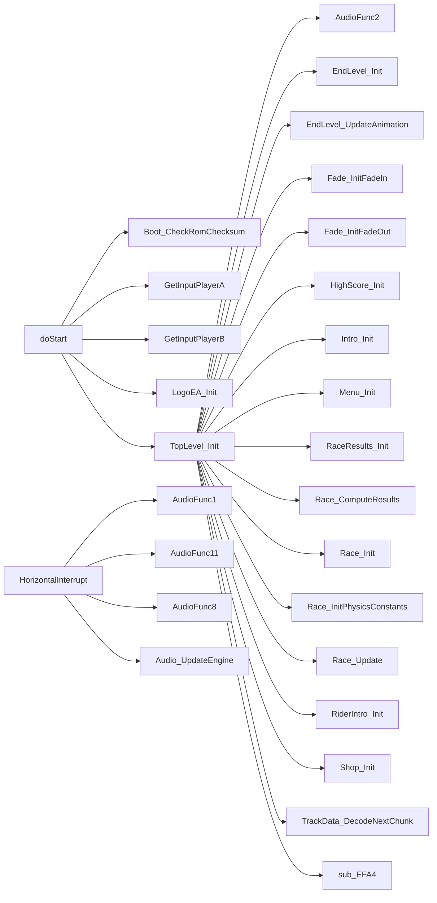

# Call graph (generated)

Generated by `tools/callgraph.py` from the `.asm` sources and
`build/roadrash.lst`. Best effort: `jsr`/`bsr`/`jmp` targets only;
indirect calls (e.g. `jsr (a0)`) are counted but not resolved.

## Summary

- Functions/symbols: **385**
- Resolved call edges: **679**
- Indirect calls seen: **9**

Notes: `VerticalInterrupt` calls the pointer stored in `ram_UpdateFunction`
and `FadeWithFunction_GameTick` calls `Fade_ram_UpdateFunction` indirectly;
those edges are not resolved here.

## Entry points / selected roots

## Function index

| Function | Address | Callers | Callees |
|---|---|---|---|
| `doStart` | `0x002FA` | - | `Boot_CheckRomChecksum`, `GetInputPlayerA`, `GetInputPlayerB`, `LogoEA_Init`, `TopLevel_Init` |
| `LogoEA_GameTick` | `0x00366` | - | `LogoEA_Update` |
| `LogoEA_AddSpritesVPos` | `0x0036C` | `LogoEA_Update` | - |
| `LogoEA_SetSpritesVerticalFlip` | `0x00382` | `LogoEA_Update` | - |
| `LogoEA_SetSquareSpritesHPos` | `0x00394` | `LogoEA_Update` | - |
| `LogoEA_SetTriangleSpritesHPos` | `0x003C0` | `LogoEA_Update` | - |
| `LogoEA_ShowSprites` | `0x003E2` | `LogoEA_Update` | - |
| `LogoEA_Update` | `0x00406` | `LogoEA_GameTick` | `LogoEA_AddSpritesVPos`, `LogoEA_ChangeTextColor`, `LogoEA_DrawCircle`, `LogoEA_SetSpritesVerticalFlip`, `LogoEA_SetSquareSpritesHPos`, `LogoEA_SetTriangleSpritesHPos`, `LogoEA_ShowSprites` |
| `LogoEA_CreateSprite` | `0x007BC` | `LogoEA_CreateFigureSprites` | - |
| `LogoEA_CreateFigureSprites` | `0x007E0` | `LogoEA_SetupGfx` | `LogoEA_CreateSprite` |
| `LogoEA_GetSquareLineMemOffset` | `0x00804` | `LogoEA_SetupGfx` | - |
| `LogoEA_GetPointOffsets` | `0x0080E` | `LogoEA_DrawLine` | - |
| `LogoEA_DrawLine` | `0x00824` | `LogoEA_DrawCircle`, `LogoEA_SetupGfx` | `LogoEA_GetPointOffsets` |
| `LogoEA_ChangeTextColor` | `0x0086C` | `LogoEA_Update` | - |
| `LogoEA_DrawCircle` | `0x0089A` | `LogoEA_Update` | `LogoEA_DrawLine` |
| `LogoEA_Init` | `0x0093E` | `doStart` | `LogoEA_SetupGfx` |
| `LogoEA_SetupGfx` | `0x00A08` | `LogoEA_Init` | `LogoEA_CreateFigureSprites`, `LogoEA_DecompressLZ`, `LogoEA_DrawLine`, `LogoEA_GetSquareLineMemOffset`, `LogoEA_WriteNametablePair` |
| `LogoEA_WriteNametablePair` | `0x00C32` | `LogoEA_SetupGfx` | - |
| `LogoEA_DecompressLZ` | `0x00C3C` | `LogoEA_SetupGfx` | - |
| `GetInputPlayerA` | `0x010D4` | `EndLevel_GameTick`, `EndLevel_GameTickVictoryCharacter`, `HighScore_GameTick`, `HighScore_GameTick_Demo`, `Intro_GameTick`, `MainMenu_GameTick`, `MenuPassword_GameTick`, `RaceResults_GameTick`, `Race_GetInput`, `Race_GetInputDemo`, `RiderIntro_GameTick`, `Shop_GameTick`, `doStart` | - |
| `GetInputPlayerB` | `0x0111C` | `EndLevel_GameTick`, `EndLevel_GameTickVictoryCharacter`, `HighScore_GameTick`, `HighScore_GameTick_Demo`, `Intro_GameTick`, `MainMenu_GameTick`, `MenuPassword_GameTick`, `RaceResults_GameTick`, `Race_GetInput`, `Race_GetInputDemo`, `RiderIntro_GameTick`, `Shop_GameTick`, `doStart` | - |
| `Fade_InitFadeOut` | `0x01180` | `TopLevel_Init` | - |
| `Fade_InitFadeIn` | `0x011C0` | `TopLevel_Init` | - |
| `Fade_GameTick` | `0x01242` | - | `DmaWriteCRAM` |
| `FadeWithFunction_GameTick` | `0x012F8` | - | `DmaWriteCRAM` |
| `HorizontalInterrupt` | `0x0145A` | - | `AudioFunc1`, `AudioFunc11`, `AudioFunc8`, `Audio_UpdateEngine` |
| `Audio_UpdateEngine` | `0x01652` | `HorizontalInterrupt` | - |
| `Intro_Init` | `0x01704` | `TopLevel_Init` | `AudioFunc3`, `DmaWriteVRAM`, `EncodeString`, `Intro_InitPlayerA`, `Intro_InitPlayerB`, `Rand_Init`, `UncompressW`, `WriteNametable`, `WriteToVRAM`, `sub_16088` |
| `Intro_InitPlayerA` | `0x01A2C` | `Intro_Init`, `Menu_Init` | - |
| `Intro_InitPlayerB` | `0x01B48` | `Intro_Init`, `Menu_Init` | - |
| `Intro_GameTick` | `0x01C64` | - | `AudioFunc1`, `AudioFunc4`, `DmaWriteVRAM`, `EncodeString`, `GetInputPlayerA`, `GetInputPlayerB`, `WriteNametable` |
| `EncodeString` | `0x02288` | `DrawString`, `EndLevel_InitVictoryCharacter`, `HighScore_Init`, `Intro_GameTick`, `Intro_Init`, `MainMenu_HandleInput`, `MenuPassword_CreatePassword`, `MenuPassword_DrawNamesAndPasswords`, `MenuPassword_HandleInput`, `MenuPassword_ValidatePassword`, `Menu_DrawPlayerInfo`, `Menu_ShowMessage`, `RaceResults_DrawBusted`, `RaceResults_DrawRepair`, `RaceResults_DrawStandings`, `Race_DrawOpponentName`, `Race_DrawPlayerNameOrPlace`, `Race_LoadHUD`, `RiderIntro_Init`, `Shop_DrawBikeName`, `Shop_DrawString` | - |
| `DecodeString` | `0x022B2` | `MenuPassword_CreatePassword` | - |
| `WriteNametable` | `0x02402` | `EndLevel_Init`, `EndLevel_InitVictoryCharacter`, `HighScore_Init`, `Intro_GameTick`, `Intro_Init`, `Menu_Init`, `RaceResults_DrawBusted`, `RaceResults_DrawStandings`, `RaceResults_Init`, `Race_DrawTopHud`, `Race_LoadHUD`, `Race_LoadMoreTrackGfx`, `Race_LoatTrackGfx`, `RiderIntro_Init`, `Shop_DrawBikes`, `Shop_Init` | - |
| `MenuPassword_GameTick` | `0x024CC` | - | `AudioFunc1`, `DmaWriteVRAM`, `GetInputPlayerA`, `GetInputPlayerB`, `MenuPassword_HandleInput`, `MenuPassword_SetCursorPos`, `MenuPassword_UpdateStatus`, `Menu_DrawPlayerInfo`, `Menu_DrawRaceSelection`, `Menu_ShowMessage` |
| `MenuPassword_HandleInput` | `0x02710` | `MenuPassword_GameTick` | `EncodeString`, `MenuPassword_DrawNamesAndPasswords`, `MenuPassword_SwapPlayerBlocks`, `MenuPassword_UpdateStatus`, `WriteNametableToBuffer` |
| `MenuPassword_UpdateStatus` | `0x02A1E` | `MenuPassword_GameTick`, `MenuPassword_HandleInput` | `MenuPassword_ParsePassword`, `MenuPassword_SelectCurrentTrack`, `MenuPassword_ValidatePassword` |
| `MenuPassword_SetCursorPos` | `0x02B18` | `MenuPassword_GameTick` | - |
| `MenuPassword_SelectCurrentTrack` | `0x02B2E` | `MainMenu_HandleInput`, `MenuPassword_UpdateStatus`, `Menu_Init` | - |
| `MenuPassword_SwapPlayerBlocks` | `0x02BEE` | `MenuPassword_HandleInput` | - |
| `MenuPassword_ValidatePassword` | `0x02C32` | `MenuPassword_CreatePassword`, `MenuPassword_UpdateStatus` | `EncodeString` |
| `MenuPassword_ParsePassword` | `0x02D1E` | `MenuPassword_UpdateStatus` | - |
| `MenuPassword_CreatePassword` | `0x02F3A` | `EndLevel_AdvanceLevel`, `Race_ComputeResults`, `Shop_HandleInput` | `DecodeString`, `EncodeString`, `MenuPassword_ValidatePassword` |
| `MenuPassword_DrawNamesAndPasswords` | `0x03306` | `MainMenu_HandleInput`, `MenuPassword_HandleInput` | `EncodeString`, `WriteNametableToBuffer` |
| `Menu_Init` | `0x03400` | `TopLevel_Init` | `AudioFunc3`, `DmaWriteVRAM`, `Intro_InitPlayerA`, `Intro_InitPlayerB`, `MenuPassword_SelectCurrentTrack`, `Menu_DrawPlayerInfo`, `Menu_DrawRaceSelection`, `Menu_ShowMessage`, `UncompressB`, `UncompressW`, `WriteNametable`, `WriteNametableToBuffer`, `WriteToVRAM` |
| `WriteNametableToBuffer` | `0x037AA` | `DrawString`, `EndLevel_Init`, `EndLevel_InitVictoryCharacter`, `HighScore_Init`, `MainMenu_HandleInput`, `MenuPassword_DrawNamesAndPasswords`, `MenuPassword_HandleInput`, `Menu_DrawPlayerInfo`, `Menu_DrawRaceSelection`, `Menu_Init`, `Menu_ShowMessage`, `Message_BlinkButtonC`, `Message_BlinkButtonStart`, `Message_Clear`, `Message_DrawButtonA`, `Message_DrawButtonB`, `Message_DrawDirPadRight`, `Message_DrawDirPadVert`, `Message_ShowEmpty`, `RaceResults_DrawBusted`, `RaceResults_DrawRepair`, `RaceResults_DrawStandings`, `Race_DrawOpponentName`, `Race_DrawPlayerNameOrPlace`, `Race_LoadHUD`, `RiderIntro_Init`, `Shop_DrawBikeName`, `Shop_DrawString`, `Shop_Init` | - |
| `Menu_WriteNametableMasked` | `0x037D2` | `Menu_DrawRaceCard` | - |
| `MainMenu_GameTick` | `0x03802` | - | `AudioFunc1`, `AudioFunc4`, `DmaWriteVRAM`, `GetInputPlayerA`, `GetInputPlayerB`, `MainMenu_HandleInput`, `Menu_ShowMessage`, `Rand_GetWord`, `sub_160B0`, `sub_160CC` |
| `Menu_DrawPlayerInfo` | `0x039AE` | `MainMenu_HandleInput`, `MenuPassword_GameTick`, `Menu_Init` | `EncodeString`, `UncompressW`, `WriteNametableToBuffer` |
| `Menu_BuildRaceTooltip` | `0x03B56` | `MainMenu_HandleInput` | - |
| `MainMenu_HandleInput` | `0x03BE2` | `MainMenu_GameTick` | `AudioFunc3`, `AudioFunc4`, `EncodeString`, `MenuPassword_DrawNamesAndPasswords`, `MenuPassword_SelectCurrentTrack`, `Menu_BuildRaceTooltip`, `Menu_DrawPlayerInfo`, `Menu_DrawRaceSelection`, `UncompressW`, `WriteNametableToBuffer` |
| `Menu_DrawRaceSelection` | `0x03F18` | `MainMenu_HandleInput`, `MenuPassword_GameTick`, `Menu_Init` | `Menu_DrawRaceCard`, `WriteNametableToBuffer` |
| `Menu_DrawRaceCard` | `0x0408E` | `Menu_DrawRaceSelection` | `Menu_WriteNametableMasked` |
| `Menu_ShowMessage` | `0x0417C` | `EndLevel_GameTickVictoryCharacter`, `HighScore_GameTick`, `MainMenu_GameTick`, `MenuPassword_GameTick`, `Menu_Init`, `RaceResults_GameTick`, `RiderIntro_GameTick`, `RiderIntro_Init`, `Shop_GameTick` | `EncodeString`, `Message_Clear`, `Message_ShowEmpty`, `WriteNametableToBuffer` |
| `Message_ShowEmpty` | `0x04226` | `Menu_ShowMessage` | `WriteNametableToBuffer` |
| `Message_Clear` | `0x0426A` | `Menu_ShowMessage`, `Message_BlinkButtonA`, `Message_BlinkButtonB`, `Message_BlinkButtonC`, `Message_BlinkButtonStart`, `Message_BlinkButtonsAB`, `Message_BlinkDirectionalPad`, `Message_DrawDirPadRight`, `Message_DrawDirPadVert` | `WriteNametableToBuffer` |
| `Message_BlinkButtonA` | `0x042AA` | - | `Message_Clear` |
| `Message_DrawButtonA` | `0x042D0` | `Message_BlinkButtonsAB` | `WriteNametableToBuffer` |
| `Message_BlinkButtonB` | `0x04302` | - | `Message_Clear` |
| `Message_DrawButtonB` | `0x0432A` | `Message_BlinkButtonsAB` | `WriteNametableToBuffer` |
| `Message_BlinkButtonsAB` | `0x04362` | - | `Message_Clear`, `Message_DrawButtonA`, `Message_DrawButtonB` |
| `Message_BlinkButtonC` | `0x04392` | - | `Message_Clear`, `WriteNametableToBuffer` |
| `Message_BlinkButtonStart` | `0x043F6` | - | `Message_Clear`, `WriteNametableToBuffer` |
| `Message_DrawDirPadVert` | `0x0445E` | - | `Message_Clear`, `WriteNametableToBuffer` |
| `loc_4486` | `0x04486` | `Message_BlinkDirectionalPad` | - |
| `Message_DrawDirPadRight` | `0x044D6` | - | `Message_Clear`, `WriteNametableToBuffer` |
| `loc_44FE` | `0x044FE` | `Message_BlinkDirectionalPad` | - |
| `Message_BlinkDirectionalPad` | `0x0454E` | - | `Message_Clear`, `loc_4486`, `loc_44FE` |
| `RiderSprites_Build` | `0x05760` | `RiderSprites_BuildAlt`, `Road_DrawStrip` | - |
| `RiderSprites_BuildAlt` | `0x0593E` | - | `RiderSprites_Build` |
| `RiderIntro_Init` | `0x059C4` | `TopLevel_Init` | `DmaWriteVRAM`, `EncodeString`, `Menu_ShowMessage`, `Rand_GetWord`, `UncompressB`, `UncompressW`, `WriteNametable`, `WriteNametableToBuffer`, `WriteToVRAM` |
| `RiderIntro_GameTick` | `0x05E66` | - | `AudioFunc1`, `AudioFunc4`, `DmaWriteVRAM`, `GetInputPlayerA`, `GetInputPlayerB`, `Menu_ShowMessage` |
| `RaceResults_Init` | `0x05F28` | `TopLevel_Init` | `AudioFunc3`, `AudioFunc4`, `DmaWriteVRAM`, `RaceResults_DrawBusted`, `RaceResults_DrawRepair`, `RaceResults_DrawStandings`, `Race_FormatMoney`, `UncompressB`, `UncompressW`, `WriteNametable`, `WriteToVRAM` |
| `RaceResults_DrawStandings` | `0x062CE` | `RaceResults_Init` | `EncodeString`, `UncompressW`, `WriteNametable`, `WriteNametableToBuffer`, `WriteToVRAM` |
| `RaceResults_DrawBusted` | `0x0647E` | `RaceResults_Init` | `EncodeString`, `Race_FormatNumber`, `Rand_GetWord`, `UncompressB`, `UncompressW`, `WriteNametable`, `WriteNametableToBuffer`, `WriteToVRAM` |
| `RaceResults_DrawRepair` | `0x067AC` | `RaceResults_Init` | `EncodeString`, `Race_FormatNumber`, `Rand_GetWord`, `UncompressB`, `UncompressW`, `WriteNametableToBuffer`, `WriteToVRAM` |
| `RaceResults_GameTick` | `0x06A90` | - | `AudioFunc1`, `AudioFunc4`, `DmaWriteVRAM`, `GetInputPlayerA`, `GetInputPlayerB`, `Menu_ShowMessage`, `RaceResults_HandleInput` |
| `RaceResults_HandleInput` | `0x06BD4` | `RaceResults_GameTick` | - |
| `DrawString` | `0x06C5E` | - | `EncodeString`, `WriteNametableToBuffer` |
| `HighScore_Init` | `0x06DC0` | `TopLevel_Init` | `AudioFunc3`, `AudioFunc4`, `DmaWriteVRAM`, `EncodeString`, `UncompressB`, `UncompressW`, `WriteNametable`, `WriteNametableToBuffer`, `WriteToVRAM` |
| `HighScore_GameTick_Demo` | `0x072BA` | - | `AudioFunc1`, `AudioFunc4`, `GetInputPlayerA`, `GetInputPlayerB` |
| `HighScore_GameTick` | `0x0732E` | - | `AudioFunc1`, `AudioFunc4`, `DmaWriteVRAM`, `GetInputPlayerA`, `GetInputPlayerB`, `HighScore_HandleInput`, `Menu_ShowMessage` |
| `HighScore_HandleInput` | `0x07460` | `HighScore_GameTick` | - |
| `Shop_Init` | `0x074AA` | `TopLevel_Init` | `AudioFunc3`, `AudioFunc4`, `DmaWriteVRAM`, `Shop_DrawBikeName`, `Shop_DrawBikes`, `Shop_DrawCreditsAndPrice`, `Shop_PrepareMessages`, `Shop_ShowBikeDescription`, `UncompressB`, `UncompressW`, `WriteNametable`, `WriteNametableToBuffer`, `WriteToVRAM` |
| `Shop_DrawBikeName` | `0x07996` | `Shop_HandleInput`, `Shop_Init` | `EncodeString`, `WriteNametableToBuffer` |
| `Shop_ShowBikeDescription` | `0x079DA` | `Shop_HandleInput`, `Shop_Init` | - |
| `Shop_GameTick` | `0x079F8` | - | `AudioFunc1`, `AudioFunc4`, `DmaWriteCRAM`, `DmaWriteVRAM`, `GetInputPlayerA`, `GetInputPlayerB`, `Menu_ShowMessage`, `Shop_HandleInput`, `Shop_UpdateScroll` |
| `Shop_HandleInput` | `0x07B4C` | `Shop_GameTick` | `MenuPassword_CreatePassword`, `Shop_DrawBikeName`, `Shop_DrawBikes`, `Shop_DrawCreditsAndPrice`, `Shop_PrepareMessages`, `Shop_ShowAlreadyOwned`, `Shop_ShowBikeDescription`, `Shop_ShowCannotAfford` |
| `Shop_DrawCreditsAndPrice` | `0x07D5E` | `Shop_HandleInput`, `Shop_Init` | `Race_FormatNumber`, `Shop_DrawString` |
| `Shop_DrawString` | `0x07E70` | `Shop_DrawCreditsAndPrice` | `EncodeString`, `WriteNametableToBuffer` |
| `Shop_ShowAlreadyOwned` | `0x07EA2` | `Shop_HandleInput` | - |
| `Shop_ShowCannotAfford` | `0x07F02` | `Shop_HandleInput` | - |
| `Shop_PrepareMessages` | `0x07F62` | `Shop_HandleInput`, `Shop_Init` | - |
| `Shop_DrawBikes` | `0x0803C` | `Shop_HandleInput`, `Shop_Init` | `WriteNametable` |
| `Shop_UpdateScroll` | `0x08178` | `Shop_GameTick` | - |
| `EndLevel_Init` | `0x08342` | `TopLevel_Init` | `AudioFunc3`, `AudioFunc4`, `DmaWriteVRAM`, `UncompressB`, `UncompressToVRAM`, `UncompressW`, `WriteNametable`, `WriteNametableToBuffer`, `WriteToVRAM` |
| `EndLevel_InitVictoryCharacter` | `0x08682` | `EndLevel_GameTick` | `DmaWriteCRAM`, `EncodeString`, `EndLevel_AdvanceLevel`, `Rand_GetWord`, `UncompressB`, `UncompressW`, `WriteNametable`, `WriteNametableToBuffer`, `WriteToVRAM` |
| `EndLevel_AdvanceLevel` | `0x08946` | `EndLevel_InitVictoryCharacter` | `MenuPassword_CreatePassword` |
| `EndLevel_GameTickVictoryCharacter` | `0x08A1A` | - | `AudioFunc1`, `AudioFunc4`, `DmaWriteVRAM`, `GetInputPlayerA`, `GetInputPlayerB`, `Menu_ShowMessage` |
| `EndLevel_GameTick` | `0x08AEE` | - | `AudioFunc1`, `DmaWriteVRAM`, `EndLevel_InitVictoryCharacter`, `GetInputPlayerA`, `GetInputPlayerB`, `Race_SwapFrames` |
| `EndLevel_UpdateAnimation` | `0x08B94` | `TopLevel_Init` | `Race_FinishFrame`, `UpdateAnimation2` |
| `Road_DrawStrip` | `0x08FB4` | `Road_DrawObject` | `RiderSprites_Build`, `Road_ClearEdgeTiles`, `Road_InterpolateLeftEdge`, `Road_InterpolateRightEdge`, `Road_WriteTileColumns` |
| `Road_InterpolateLeftEdge` | `0x09142` | `Road_DrawStrip` | - |
| `Road_InterpolateRightEdge` | `0x091F0` | `Road_DrawStrip` | - |
| `Road_WriteTileColumns` | `0x09306` | `Road_DrawStrip` | - |
| `Road_ClearEdgeTiles` | `0x093D2` | `Road_DrawStrip` | - |
| `Road_DrawObjects` | `0x0942A` | `Race_Update` | `Road_DrawObject` |
| `Road_DrawObject` | `0x09484` | `Road_DrawObjects` | `Road_DrawStrip`, `Road_ProjectShape`, `Road_ProjectShapeSpecial`, `Road_ScaleShape` |
| `Road_ScaleShape` | `0x0978C` | `Road_DrawObject` | - |
| `Road_ProjectShapeSpecial` | `0x097BC` | `Road_DrawObject` | - |
| `Road_ProjectShape` | `0x09836` | `Road_DrawObject` | - |
| `RaceHud_DrawStandings` | `0x098C2` | - | `RaceHud_WriteDigit2`, `RaceHud_WriteDigit4` |
| `RaceDebug_ShowDistanceTravelled` | `0x09936` | - | `RaceHud_WriteDigit4`, `sub_F11C` |
| `RaceDebug_ShowPosZ` | `0x0995A` | - | `RaceHud_WriteDigit4`, `sub_F11C` |
| `RaceDebug_ShowFrameDelay` | `0x0997E` | - | `RaceHud_WriteDigit4`, `sub_F11C` |
| `sub_999E` | `0x0999E` | - | `RaceHud_WriteDigit2`, `sub_F11C` |
| `RaceDebug_ShowState` | `0x099C2` | - | `RaceHud_WriteDigit4` |
| `sub_9A98` | `0x09A98` | - | `RaceHud_WriteDigit4` |
| `RaceHud_DrawGear` | `0x09AB4` | - | `RaceHud_WriteDigit1` |
| `RaceHud_WriteDigit1` | `0x09AD4` | `RaceHud_DrawGear` | - |
| `RaceHud_WriteDigit2` | `0x09AF4` | `RaceHud_DrawStandings`, `sub_999E` | - |
| `RaceHud_WriteDigit4` | `0x09B34` | `RaceDebug_ShowDistanceTravelled`, `RaceDebug_ShowFrameDelay`, `RaceDebug_ShowPosZ`, `RaceDebug_ShowState`, `RaceHud_DrawStandings`, `sub_9A98` | - |
| `UncompressB` | `0x09B9E` | `EndLevel_Init`, `EndLevel_InitVictoryCharacter`, `HighScore_Init`, `Menu_Init`, `RaceResults_DrawBusted`, `RaceResults_DrawRepair`, `RaceResults_Init`, `Race_LoatTrackGfx`, `RiderIntro_Init`, `Shop_Init` | - |
| `UncompressW` | `0x09C26` | `EndLevel_Init`, `EndLevel_InitVictoryCharacter`, `HighScore_Init`, `Intro_Init`, `MainMenu_HandleInput`, `Menu_DrawPlayerInfo`, `Menu_Init`, `RaceResults_DrawBusted`, `RaceResults_DrawRepair`, `RaceResults_DrawStandings`, `RaceResults_Init`, `Race_DrawTopHud`, `Race_LoadFonts`, `Race_LoadHUD`, `Race_LoadMoreTrackGfx`, `Race_LoadRoadImage`, `RiderIntro_Init`, `Shop_Init` | - |
| `UncompressToVRAM` | `0x09EF8` | `EndLevel_Init` | - |
| `TrackData_StartDecode` | `0x09FE4` | `TrackData_InitLevel` | `TrackData_DecodeChunk` |
| `TrackData_DecodeChunk` | `0x0A04A` | `TrackData_DecodeNextChunk`, `TrackData_StartDecode` | `TrackData_DecodeChannel1`, `TrackData_DecodeChannel2` |
| `TrackData_DecodeChannel1` | `0x0A0D4` | `TrackData_DecodeChunk` | - |
| `TrackData_DecodeChannel2` | `0x0A2DA` | `TrackData_DecodeChunk` | - |
| `Race_Init` | `0x0A4E2` | `TopLevel_Init` | `Race_ClearFrameBuffers`, `Race_ClearHudCorners`, `Race_CreateActors`, `Race_DrawTopHud`, `Race_GameTick`, `Race_InitActorLists`, `Race_InitActorPositions`, `Race_InitAudio`, `Race_InitTrack`, `Race_InitVariables`, `Race_InitVdp`, `Race_LoadBikeData`, `Race_LoadBikePalette`, `Race_LoadFonts`, `Race_LoadHUD`, `Race_LoadMoreTrackGfx`, `Race_LoadRoadImage`, `Race_LoadTrackParams`, `Race_LoatTrackGfx`, `Race_SpawnOpponents`, `Race_Update`, `TrackData_InitLevel` |
| `Race_InitAudio` | `0x0A674` | `Race_Init` | `AudioFunc11`, `AudioFunc12`, `AudioFunc14`, `AudioFunc3`, `AudioFunc6`, `AudioFunc8`, `AudioFunc9` |
| `Race_InitVdp` | `0x0A72A` | `Race_Init` | - |
| `Race_DrawTopHud` | `0x0A79C` | `Race_Init` | `UncompressW`, `WriteNametable`, `WriteToVRAM` |
| `Race_LoatTrackGfx` | `0x0A90A` | `Race_Init` | `UncompressB`, `WriteNametable`, `WriteToVRAM` |
| `Race_LoadMoreTrackGfx` | `0x0A9DE` | `Race_Init` | `UncompressW`, `WriteNametable`, `WriteToVRAM` |
| `Race_ClearFrameBuffers` | `0x0AB38` | `Race_Init` | `Race_FillHudTile` |
| `Race_ClearHudCorners` | `0x0AB78` | `Race_Init` | - |
| `Race_FillHudTile` | `0x0AB9A` | `Race_ClearFrameBuffers` | - |
| `Race_LoadHUD` | `0x0ABBA` | `Race_Init` | `EncodeString`, `UncompressW`, `WriteNametable`, `WriteNametableToBuffer`, `WriteToVRAM` |
| `Race_LoadRoadImage` | `0x0ADFC` | `Race_Init` | `UncompressW`, `WriteToVRAM`, `sub_D9DA` |
| `Race_LoadFonts` | `0x0AF40` | `Race_Init` | `UncompressW`, `WriteToVRAM` |
| `WriteToVRAM` | `0x0AFF2` | `EndLevel_Init`, `EndLevel_InitVictoryCharacter`, `HighScore_Init`, `Intro_Init`, `Menu_Init`, `RaceResults_DrawBusted`, `RaceResults_DrawRepair`, `RaceResults_DrawStandings`, `RaceResults_Init`, `Race_DrawTopHud`, `Race_LoadFonts`, `Race_LoadHUD`, `Race_LoadMoreTrackGfx`, `Race_LoadRoadImage`, `Race_LoatTrackGfx`, `RiderIntro_Init`, `Shop_Init` | - |
| `Race_InitTrack` | `0x0B016` | `Race_Init` | - |
| `Race_InitVariables` | `0x0B0E8` | `Race_Init` | - |
| `Race_InitActorLists` | `0x0B6C4` | `Race_Init` | - |
| `Race_InitActorPositions` | `0x0B72A` | `Race_Init` | - |
| `Race_InitPhysicsConstants` | `0x0B770` | `TopLevel_Init` | - |
| `Race_LoadTrackParams` | `0x0B840` | `Race_Init` | - |
| `Race_LoadBikeData` | `0x0B86A` | `Race_Init` | - |
| `Race_SpawnOpponents` | `0x0B8D0` | `Race_Init` | `Rand_GetWord` |
| `Race_ResetFrameTimers` | `0x0B9AE` | `Race_GameTick` | - |
| `Race_UpdateTime` | `0x0BA02` | `Race_GameTick` | - |
| `Race_GameTick` | `0x0BA76` | `Race_Init` | `AudioFunc10`, `AudioFunc13`, `AudioFunc7`, `DmaWriteCRAM`, `DmaWriteVRAM`, `Race_GetInput`, `Race_GetInputDemo`, `Race_ResetFrameTimers`, `Race_SwapFrames`, `Race_UpdateTime`, `Race_WriteSpriteTiles` |
| `Race_SwapFrames` | `0x0BBFE` | `EndLevel_GameTick`, `Race_GameTick` | - |
| `Race_FinishFrame` | `0x0BD24` | `EndLevel_UpdateAnimation`, `Race_Update` | - |
| `Race_GetInputDemo` | `0x0BE2C` | `Race_GameTick` | `GetInputPlayerA`, `GetInputPlayerB` |
| `Race_GetInput` | `0x0BE56` | `Race_GameTick` | `AudioFunc18`, `AudioFunc4`, `GetInputPlayerA`, `GetInputPlayerB` |
| `Race_Update` | `0x0C00C` | `Race_Init`, `TopLevel_Init` | `PiecewiseLinearInterpolation`, `RaceHud_Draw`, `Race_FinishFrame`, `RoadMarking_Draw`, `Road_BuildVisibleList`, `Road_DrawObjects`, `Road_FillProfileTables`, `sub_109B6`, `sub_10DBE`, `sub_10DDA`, `sub_10E66`, `sub_11C44`, `sub_11CC8`, `sub_1218C`, `sub_123A8`, `sub_1281E`, `sub_12868`, `sub_128E0`, `sub_12974`, `sub_12EA2`, `sub_13106`, `sub_1383E`, `sub_138CE`, `sub_13A92`, `sub_13BF4`, `sub_13E94`, `sub_13EA0`, `sub_14E38`, `sub_160E2`, `sub_1611A`, `sub_16AF6`, `sub_D9DA`, `sub_DD84`, `sub_DE9E`, `sub_E004`, `sub_E494`, `sub_E5EE`, `sub_EC90`, `sub_EDD0`, `sub_F108`, `sub_F40C`, `sub_FB1E`, `sub_FC0E`, `sub_FD96` |
| `Race_SortResults` | `0x0C378` | `Race_ComputeResults` | - |
| `Race_ComputeResults` | `0x0C3F8` | `TopLevel_Init` | `MenuPassword_CreatePassword`, `Race_BuildStandings`, `Race_SortResults`, `Race_UpdateHighScoreTable` |
| `Race_UpdateHighScoreTable` | `0x0C598` | `Race_ComputeResults` | `Race_FormatMoney` |
| `Race_FormatMoney` | `0x0C6C4` | `RaceResults_Init`, `Race_UpdateHighScoreTable` | - |
| `Race_FormatNumber` | `0x0C79A` | `RaceResults_DrawBusted`, `RaceResults_DrawRepair`, `Race_BuildStandings`, `Shop_DrawCreditsAndPrice` | - |
| `Race_BuildStandings` | `0x0C868` | `Race_ComputeResults` | `Race_FormatNumber`, `Race_FormatTime` |
| `Race_FormatTime` | `0x0C9D4` | `Race_BuildStandings` | - |
| `Race_LoadBikePalette` | `0x0CA50` | `Race_Init` | - |
| `Race_LoadActorPalette` | `0x0CAAE` | `Race_CreateActors` | - |
| `Race_CreateActors` | `0x0CAD0` | `Race_Init` | `Race_LoadActorPalette` |
| `RaceHud_Draw` | `0x0D278` | `Race_Update` | `RaceHud_DrawOdometer`, `RaceHud_DrawPlace`, `RaceHud_DrawRPMArrow`, `RaceHud_DrawSpeedArrow`, `RaceHud_DrawStamina`, `RaceHud_DrawTime`, `Race_DrawBikeHPBar`, `Race_DrawOpponentName`, `Race_DrawPlayerNameOrPlace` |
| `RaceHud_DrawSpeedArrow` | `0x0D29E` | `RaceHud_Draw` | `UpdateAnimation` |
| `RaceHud_DrawRPMArrow` | `0x0D2DC` | `RaceHud_Draw` | `UpdateAnimation` |
| `RaceHud_DrawOdometer` | `0x0D334` | `RaceHud_Draw` | - |
| `RaceHud_DrawPlace` | `0x0D3F6` | `RaceHud_Draw` | `RaceHud_DrawNumber2Digits` |
| `RaceHud_DrawTime` | `0x0D410` | `RaceHud_Draw` | `RaceHud_DrawNumber2Digits`, `RaceHud_DrawSymbol` |
| `RaceHud_DrawStamina` | `0x0D458` | `RaceHud_Draw` | - |
| `Race_DrawBikeHPBar` | `0x0D534` | `RaceHud_Draw` | - |
| `Race_DrawPlayerNameOrPlace` | `0x0D5CE` | `RaceHud_Draw` | `EncodeString`, `WriteNametableToBuffer` |
| `Race_DrawOpponentName` | `0x0D73A` | `RaceHud_Draw` | `EncodeString`, `WriteNametableToBuffer` |
| `RaceHud_DrawSymbol` | `0x0D830` | `RaceHud_DrawTime` | - |
| `RaceHud_DrawNumber2Digits` | `0x0D850` | `RaceHud_DrawPlace`, `RaceHud_DrawTime` | - |
| `DmaWriteVRAM` | `0x0D8FA` | `EndLevel_GameTick`, `EndLevel_GameTickVictoryCharacter`, `EndLevel_Init`, `HighScore_GameTick`, `HighScore_Init`, `Intro_GameTick`, `Intro_Init`, `MainMenu_GameTick`, `MenuPassword_GameTick`, `Menu_Init`, `RaceResults_GameTick`, `RaceResults_Init`, `Race_GameTick`, `Race_WriteSpriteTiles`, `RiderIntro_GameTick`, `RiderIntro_Init`, `Shop_GameTick`, `Shop_Init` | - |
| `DmaWriteCRAM` | `0x0D96A` | `EndLevel_InitVictoryCharacter`, `FadeWithFunction_GameTick`, `Fade_GameTick`, `Race_GameTick`, `Shop_GameTick` | - |
| `sub_D9DA` | `0x0D9DA` | `Race_LoadRoadImage`, `Race_Update` | `sub_DA3E` |
| `sub_DA3E` | `0x0DA3E` | `sub_D9DA` | - |
| `sub_DAE2` | `0x0DAE2` | `sub_F40C` | `sub_102E4` |
| `sub_DD84` | `0x0DD84` | `Race_Update` | - |
| `sub_DE9E` | `0x0DE9E` | `Race_Update` | - |
| `sub_E004` | `0x0E004` | `Race_Update` | - |
| `sub_E494` | `0x0E494` | `Race_Update` | - |
| `sub_E5EE` | `0x0E5EE` | `Race_Update` | - |
| `RoadMarking_Draw` | `0x0E75E` | `Race_Update` | `RoadMarking_ClearSpriteTiles`, `RoadMarking_CreateSprite`, `RoadMarking_FindUnprocessedLine`, `RoadMarking_GetMarkingsSizes`, `RoadMarking_SetSpriteGeometry` |
| `RoadMarking_FindUnprocessedLine` | `0x0E7B0` | `RoadMarking_Draw` | - |
| `RoadMarking_GetMarkingsSizes` | `0x0E7DA` | `RoadMarking_Draw` | - |
| `RoadMarking_SetSpriteGeometry` | `0x0E934` | `RoadMarking_Draw` | - |
| `RoadMarking_ClearSpriteTiles` | `0x0E9D2` | `RoadMarking_Draw` | - |
| `RoadMarking_CreateSprite` | `0x0E9F8` | `RoadMarking_Draw` | - |
| `sub_EC90` | `0x0EC90` | `Race_Update` | - |
| `Road_FillProfileTables` | `0x0ECE0` | `Race_Update` | - |
| `sub_EDD0` | `0x0EDD0` | `Race_Update` | - |
| `sub_EFA4` | `0x0EFA4` | `TopLevel_Init` | `Rand_GetWord`, `sub_F0E4` |
| `sub_F0E4` | `0x0F0E4` | `sub_EFA4` | - |
| `sub_F108` | `0x0F108` | `Race_Update` | `sub_F11C` |
| `sub_F11C` | `0x0F11C` | `RaceDebug_ShowDistanceTravelled`, `RaceDebug_ShowFrameDelay`, `RaceDebug_ShowPosZ`, `sub_999E`, `sub_F108` | - |
| `PiecewiseLinearInterpolation` | `0x0F180` | `Race_Update` | `FillLinearInterpArray` |
| `FillLinearInterpArray` | `0x0F1AE` | `PiecewiseLinearInterpolation` | - |
| `sub_F40C` | `0x0F40C` | `Race_Update` | `sub_100D0`, `sub_10256`, `sub_10294`, `sub_108DA`, `sub_15014`, `sub_DAE2`, `sub_F842`, `sub_F90E`, `sub_F9C4`, `sub_FA98`, `sub_FE3A`, `sub_FF7E` |
| `sub_F842` | `0x0F842` | `sub_F40C` | `sub_FE3A` |
| `sub_F90E` | `0x0F90E` | `sub_F40C` | `sub_FE3A` |
| `sub_F9C4` | `0x0F9C4` | `sub_F40C` | `sub_FE3A` |
| `sub_FA98` | `0x0FA98` | `sub_F40C` | `sub_FE3A` |
| `sub_FB1E` | `0x0FB1E` | `Race_Update` | `sub_15478`, `sub_FE3A` |
| `sub_FC0E` | `0x0FC0E` | `Race_Update` | `sub_FE3A` |
| `sub_FD96` | `0x0FD96` | `Race_Update` | - |
| `sub_FE3A` | `0x0FE3A` | `sub_F40C`, `sub_F842`, `sub_F90E`, `sub_F9C4`, `sub_FA98`, `sub_FB1E`, `sub_FC0E` | - |
| `sub_FF7E` | `0x0FF7E` | `sub_F40C` | - |
| `sub_100D0` | `0x100D0` | `sub_1030A`, `sub_10384`, `sub_F40C` | `sub_101EA`, `sub_1022E`, `sub_1030A`, `sub_1081A` |
| `sub_101EA` | `0x101EA` | `sub_100D0` | - |
| `sub_1022E` | `0x1022E` | `sub_100D0` | - |
| `sub_10256` | `0x10256` | `sub_F40C` | - |
| `sub_10294` | `0x10294` | `sub_F40C` | - |
| `sub_102E4` | `0x102E4` | `sub_DAE2` | - |
| `sub_1030A` | `0x1030A` | `sub_100D0` | `sub_100D0`, `sub_10384`, `sub_10762` |
| `sub_10384` | `0x10384` | `sub_1030A` | `sub_100D0`, `sub_104E6` |
| `sub_104E6` | `0x104E6` | `sub_10384` | - |
| `sub_10762` | `0x10762` | `sub_1030A` | - |
| `sub_1081A` | `0x1081A` | `sub_100D0` | - |
| `sub_108DA` | `0x108DA` | `sub_F40C` | - |
| `Race_WriteSpriteTiles` | `0x10972` | `Race_GameTick` | `DmaWriteVRAM` |
| `sub_109B6` | `0x109B6` | `Race_Update` | `sub_10C4E` |
| `sub_10C4E` | `0x10C4E` | `sub_109B6` | - |
| `Road_BuildVisibleList` | `0x10D46` | `Race_Update` | - |
| `sub_10DBE` | `0x10DBE` | `Race_Update` | `sub_10E00` |
| `sub_10DDA` | `0x10DDA` | `Race_Update` | `sub_10E00` |
| `sub_10E00` | `0x10E00` | `sub_10DBE`, `sub_10DDA` | - |
| `sub_10E66` | `0x10E66` | `Race_Update` | `Race_HandleInputOnFoot`, `sub_1103A`, `sub_113A4`, `sub_113CA`, `sub_11448`, `sub_116E2`, `sub_1180C`, `sub_11940`, `sub_11B7A`, `sub_12BD2`, `sub_13746`, `sub_13EFA` |
| `sub_1103A` | `0x1103A` | `sub_10E66` | `sub_12BD2` |
| `Race_HandleInputOnFoot` | `0x110AE` | `sub_10E66` | `Race_AnotherInputOnFoot`, `sub_11268`, `sub_11448`, `sub_116E2`, `sub_11940` |
| `Race_AnotherInputOnFoot` | `0x111FA` | `Race_HandleInputOnFoot` | `sub_11268` |
| `sub_11268` | `0x11268` | `Race_AnotherInputOnFoot`, `Race_HandleInputOnFoot` | `sub_112C8` |
| `sub_112C8` | `0x112C8` | `sub_11268` | - |
| `sub_113A4` | `0x113A4` | `sub_10E66`, `sub_12868` | `sub_1406A` |
| `sub_113CA` | `0x113CA` | `sub_10E66` | `sub_1406A` |
| `sub_11448` | `0x11448` | `Race_HandleInputOnFoot`, `sub_10E66` | `sub_115C6` |
| `sub_115C6` | `0x115C6` | `sub_11448`, `sub_116E2`, `sub_11940` | `sub_146AC` |
| `sub_116E2` | `0x116E2` | `Race_HandleInputOnFoot`, `sub_10E66`, `sub_1180C`, `sub_12868` | `sub_115C6` |
| `sub_1180C` | `0x1180C` | `sub_10E66` | `sub_116E2`, `sub_11940`, `sub_13BD8` |
| `sub_11906` | `0x11906` | `sub_11B7A`, `sub_11CC8`, `sub_1218C`, `sub_12BD2`, `sub_14C3C` | - |
| `sub_11940` | `0x11940` | `Race_HandleInputOnFoot`, `sub_10E66`, `sub_1180C`, `sub_12868` | `sub_115C6` |
| `sub_11B7A` | `0x11B7A` | `sub_10E66` | `sub_11906`, `sub_1434A`, `sub_15538` |
| `sub_11C44` | `0x11C44` | `Race_Update` | - |
| `sub_11CC8` | `0x11CC8` | `Race_Update` | `sub_11906`, `sub_12070`, `sub_12414`, `sub_124E2`, `sub_12A9C`, `sub_1438E`, `sub_14486`, `sub_1487C` |
| `sub_12070` | `0x12070` | `sub_11CC8`, `sub_1218C` | - |
| `sub_1218C` | `0x1218C` | `Race_Update` | `sub_11906`, `sub_12070`, `sub_124E2`, `sub_1438E`, `sub_14486`, `sub_1487C` |
| `sub_123A8` | `0x123A8` | `Race_Update` | `sub_124E2` |
| `sub_12414` | `0x12414` | `sub_11CC8` | - |
| `sub_124E2` | `0x124E2` | `sub_11CC8`, `sub_1218C`, `sub_123A8` | `sub_12A88`, `sub_12B0C`, `sub_12B24` |
| `sub_1281E` | `0x1281E` | `Race_Update` | - |
| `sub_12868` | `0x12868` | `Race_Update` | `sub_113A4`, `sub_116E2`, `sub_11940`, `sub_12C9A`, `sub_137E4`, `sub_13DE0` |
| `sub_128E0` | `0x128E0` | `Race_Update` | `Rand_GetWord` |
| `sub_12974` | `0x12974` | `Race_Update` | - |
| `sub_12A88` | `0x12A88` | `sub_124E2` | `sub_12A9C`, `sub_12AF8` |
| `sub_12A9C` | `0x12A9C` | `sub_11CC8`, `sub_12A88` | - |
| `sub_12AF8` | `0x12AF8` | `sub_12A88` | - |
| `sub_12B0C` | `0x12B0C` | `sub_124E2` | - |
| `sub_12B24` | `0x12B24` | `sub_124E2` | - |
| `sub_12BD2` | `0x12BD2` | `sub_10E66`, `sub_1103A` | `sub_11906`, `sub_12CCE`, `sub_15538`, `sub_1555C` |
| `sub_12C9A` | `0x12C9A` | `sub_12868` | - |
| `sub_12CCE` | `0x12CCE` | `sub_12BD2` | - |
| `sub_12EA2` | `0x12EA2` | `Race_Update` | `sub_13A92`, `sub_16C9A`, `sub_16CAE` |
| `sub_13106` | `0x13106` | `Race_Update` | - |
| `sub_131BE` | `0x131BE` | `sub_165D0`, `sub_16612`, `sub_16644`, `sub_1666A`, `sub_166B0`, `sub_166F0` | `sub_13A92`, `sub_13FE6` |
| `sub_13292` | `0x13292` | `sub_166DC` | `sub_13A92`, `sub_13FE6` |
| `sub_1333C` | `0x1333C` | `sub_16612`, `sub_16644`, `sub_1666A`, `sub_166B0`, `sub_166DC`, `sub_166F0` | `sub_136B6` |
| `sub_13422` | `0x13422` | `sub_166F0` | `sub_135F6`, `sub_13892` |
| `sub_135F6` | `0x135F6` | `sub_13422`, `sub_16458`, `sub_166F0` | `sub_13626` |
| `sub_13626` | `0x13626` | `sub_135F6` | - |
| `sub_136B6` | `0x136B6` | `sub_1333C` | - |
| `sub_13746` | `0x13746` | `sub_10E66`, `sub_16D9A` | `sub_13812` |
| `sub_137E4` | `0x137E4` | `sub_12868` | `sub_13812` |
| `sub_13812` | `0x13812` | `sub_13746`, `sub_137E4` | - |
| `sub_1383E` | `0x1383E` | `Race_Update` | - |
| `sub_1384C` | `0x1384C` | `sub_165D0`, `sub_165E0`, `sub_1666A` | - |
| `sub_13892` | `0x13892` | `sub_13422` | - |
| `sub_138CE` | `0x138CE` | `Race_Update` | `Rand_GetWord`, `sub_13A26` |
| `sub_13A26` | `0x13A26` | `sub_138CE` | - |
| `sub_13A92` | `0x13A92` | `Race_Update`, `sub_12EA2`, `sub_131BE`, `sub_13292`, `sub_1634E`, `sub_165E0` | `sub_13BBC` |
| `sub_13BBC` | `0x13BBC` | `sub_13A92` | - |
| `sub_13BD8` | `0x13BD8` | `sub_1180C` | - |
| `sub_13BF4` | `0x13BF4` | `Race_Update` | `sub_13CFE` |
| `sub_13CFE` | `0x13CFE` | `sub_13BF4` | `sub_13FE6`, `sub_16D0A`, `sub_16D9A` |
| `sub_13D44` | `0x13D44` | `sub_16458` | - |
| `sub_13DE0` | `0x13DE0` | `sub_12868` | - |
| `sub_13E94` | `0x13E94` | `Race_Update` | `sub_13FE6` |
| `sub_13EA0` | `0x13EA0` | `Race_Update` | - |
| `sub_13EFA` | `0x13EFA` | `sub_10E66` | - |
| `sub_13FE6` | `0x13FE6` | `sub_131BE`, `sub_13292`, `sub_13CFE`, `sub_13E94`, `sub_16D2A`, `sub_16D60` | - |
| `sub_1406A` | `0x1406A` | `sub_113A4`, `sub_113CA` | - |
| `sub_142D8` | `0x142D8` | `sub_14486` | - |
| `sub_1434A` | `0x1434A` | `sub_11B7A`, `sub_14486`, `sub_14CEC` | - |
| `sub_1438E` | `0x1438E` | `sub_11CC8`, `sub_1218C` | - |
| `sub_14486` | `0x14486` | `sub_11CC8`, `sub_1218C` | `sub_142D8`, `sub_1434A`, `sub_145EC`, `sub_14688` |
| `sub_145EC` | `0x145EC` | `sub_14486`, `sub_14CEC` | `sub_15538`, `sub_1555C` |
| `sub_14688` | `0x14688` | `sub_14486` | - |
| `sub_146AC` | `0x146AC` | `sub_115C6` | - |
| `sub_1487C` | `0x1487C` | `sub_11CC8`, `sub_1218C` | `sub_1496C`, `sub_149C4`, `sub_14B04`, `sub_14C3C`, `sub_14CEC`, `sub_14D84` |
| `sub_1496C` | `0x1496C` | `sub_1487C` | - |
| `sub_149C4` | `0x149C4` | `sub_1487C` | - |
| `sub_14B04` | `0x14B04` | `sub_1487C` | - |
| `sub_14C3C` | `0x14C3C` | `sub_1487C` | `sub_11906` |
| `sub_14CEC` | `0x14CEC` | `sub_1487C` | `sub_1434A`, `sub_145EC`, `sub_14D84` |
| `sub_14D84` | `0x14D84` | `sub_1487C`, `sub_14CEC` | - |
| `sub_14E38` | `0x14E38` | `Race_Update` | `AudioFunc10`, `AudioFunc13`, `AudioFunc15`, `AudioFunc16`, `AudioFunc17`, `AudioFunc5`, `AudioFunc7` |
| `sub_14FB4` | `0x14FB4` | `sub_1611A` | - |
| `sub_15014` | `0x15014` | `sub_F40C` | `sub_151F0`, `sub_1533E`, `sub_15446`, `sub_154D2` |
| `sub_151F0` | `0x151F0` | `sub_15014` | - |
| `sub_1533E` | `0x1533E` | `sub_15014` | - |
| `sub_15446` | `0x15446` | `sub_15014` | - |
| `sub_15478` | `0x15478` | `sub_FB1E` | `sub_154D2` |
| `sub_154D2` | `0x154D2` | `sub_15014`, `sub_15478` | - |
| `sub_15538` | `0x15538` | `sub_11B7A`, `sub_12BD2`, `sub_145EC` | `Rand_GetWord` |
| `sub_1555C` | `0x1555C` | `sub_12BD2`, `sub_145EC` | `Rand_GetWord` |
| `Rand_Init` | `0x15FE8` | `Intro_Init` | - |
| `Rand_GetWord` | `0x16034` | `EndLevel_InitVictoryCharacter`, `MainMenu_GameTick`, `RaceResults_DrawBusted`, `RaceResults_DrawRepair`, `Race_SpawnOpponents`, `RiderIntro_Init`, `sub_128E0`, `sub_138CE`, `sub_15538`, `sub_1555C`, `sub_1607C`, `sub_1662C`, `sub_16AF6`, `sub_EFA4` | - |
| `sub_1607C` | `0x1607C` | - | `Rand_GetWord` |
| `sub_16088` | `0x16088` | `Intro_Init` | - |
| `sub_160B0` | `0x160B0` | `MainMenu_GameTick` | - |
| `sub_160CC` | `0x160CC` | `MainMenu_GameTick` | - |
| `sub_160E2` | `0x160E2` | `Race_Update` | - |
| `sub_1611A` | `0x1611A` | `Race_Update` | `Audio_UpdateEngine0`, `sub_14FB4`, `sub_162B0` |
| `sub_162B0` | `0x162B0` | `sub_1611A` | - |
| `sub_1634E` | `0x1634E` | - | `sub_13A92` |
| `sub_16458` | `0x16458` | - | `sub_135F6`, `sub_13D44`, `sub_16548` |
| `Audio_UpdateEngine0` | `0x16520` | `sub_1611A`, `sub_16548` | - |
| `sub_16548` | `0x16548` | `sub_16458` | `Audio_UpdateEngine0` |
| `sub_165D0` | `0x165D0` | - | `sub_131BE`, `sub_1384C` |
| `sub_165E0` | `0x165E0` | `sub_16624` | `sub_1384C`, `sub_13A92` |
| `sub_16612` | `0x16612` | `sub_1662C`, `sub_166B0` | `sub_131BE`, `sub_1333C`, `sub_16732` |
| `sub_16624` | `0x16624` | - | `sub_165E0`, `sub_16732` |
| `sub_1662C` | `0x1662C` | `sub_16644` | `Rand_GetWord`, `sub_16612`, `sub_1666A` |
| `sub_16644` | `0x16644` | - | `sub_131BE`, `sub_1333C`, `sub_1662C` |
| `sub_1666A` | `0x1666A` | `sub_1662C` | `sub_131BE`, `sub_1333C`, `sub_1384C` |
| `sub_166B0` | `0x166B0` | - | `sub_131BE`, `sub_1333C`, `sub_16612` |
| `sub_166DC` | `0x166DC` | - | `sub_13292`, `sub_1333C` |
| `sub_166F0` | `0x166F0` | - | `sub_131BE`, `sub_1333C`, `sub_13422`, `sub_135F6`, `sub_16732` |
| `sub_16732` | `0x16732` | `sub_16612`, `sub_16624`, `sub_166F0` | - |
| `UpdateAnimation` | `0x16860` | `RaceHud_DrawRPMArrow`, `RaceHud_DrawSpeedArrow` | - |
| `UpdateAnimation2` | `0x16926` | `EndLevel_UpdateAnimation` | - |
| `TrackData_InitLevel` | `0x169B0` | `Race_Init` | `TrackData_StartDecode` |
| `TrackData_DecodeNextChunk` | `0x16A32` | `TopLevel_Init` | `TrackData_DecodeChunk` |
| `sub_16AF6` | `0x16AF6` | `Race_Update` | `Rand_GetWord`, `sub_16BD6`, `sub_16C1A` |
| `sub_16B6A` | `0x16B6A` | `sub_16BD6` | `sub_16BC8`, `sub_16E48` |
| `sub_16B9E` | `0x16B9E` | `sub_16C1A` | `sub_16BC8`, `sub_16E48` |
| `sub_16BC8` | `0x16BC8` | `sub_16B6A`, `sub_16B9E` | - |
| `sub_16BD6` | `0x16BD6` | `sub_16AF6` | `sub_16B6A`, `sub_16D0A`, `sub_16D2A`, `sub_16E54` |
| `sub_16C1A` | `0x16C1A` | `sub_16AF6` | `sub_16B9E`, `sub_16C4E`, `sub_16D0A`, `sub_16D60`, `sub_16E54` |
| `sub_16C4E` | `0x16C4E` | `sub_16C1A` | - |
| `sub_16C9A` | `0x16C9A` | `sub_12EA2` | `sub_16E26`, `sub_16E48` |
| `sub_16CAE` | `0x16CAE` | `sub_12EA2` | `sub_16E26`, `sub_16E48` |
| `sub_16D0A` | `0x16D0A` | `sub_13CFE`, `sub_16BD6`, `sub_16C1A` | - |
| `sub_16D2A` | `0x16D2A` | `sub_16BD6` | `sub_13FE6`, `sub_16D9A` |
| `sub_16D60` | `0x16D60` | `sub_16C1A` | `sub_13FE6`, `sub_16D9A` |
| `sub_16D9A` | `0x16D9A` | `sub_13CFE`, `sub_16D2A`, `sub_16D60` | `sub_13746` |
| `sub_16E26` | `0x16E26` | `sub_16C9A`, `sub_16CAE` | - |
| `sub_16E48` | `0x16E48` | `sub_16B6A`, `sub_16B9E`, `sub_16C9A`, `sub_16CAE` | - |
| `sub_16E54` | `0x16E54` | `sub_16BD6`, `sub_16C1A` | - |
| `AudioFunc1` | `0x19F62` | `EndLevel_GameTick`, `EndLevel_GameTickVictoryCharacter`, `HighScore_GameTick`, `HighScore_GameTick_Demo`, `HorizontalInterrupt`, `Intro_GameTick`, `MainMenu_GameTick`, `MenuPassword_GameTick`, `RaceResults_GameTick`, `RiderIntro_GameTick`, `Shop_GameTick` | - |
| `AudioFunc2` | `0x19F66` | `TopLevel_Init` | - |
| `AudioFunc3` | `0x19F6A` | `EndLevel_Init`, `HighScore_Init`, `Intro_Init`, `MainMenu_HandleInput`, `Menu_Init`, `RaceResults_Init`, `Race_InitAudio`, `Shop_Init` | - |
| `AudioFunc4` | `0x19F6E` | `EndLevel_GameTickVictoryCharacter`, `EndLevel_Init`, `HighScore_GameTick`, `HighScore_GameTick_Demo`, `HighScore_Init`, `Intro_GameTick`, `MainMenu_GameTick`, `MainMenu_HandleInput`, `RaceResults_GameTick`, `RaceResults_Init`, `Race_GetInput`, `RiderIntro_GameTick`, `Shop_GameTick`, `Shop_Init` | - |
| `AudioFunc5` | `0x19F72` | `sub_14E38` | - |
| `AudioFunc6` | `0x19F76` | `Race_InitAudio` | - |
| `AudioFunc7` | `0x19F7A` | `Race_GameTick`, `sub_14E38` | - |
| `AudioFunc8` | `0x19F7E` | `HorizontalInterrupt`, `Race_InitAudio` | - |
| `AudioFunc9` | `0x19F82` | `Race_InitAudio` | - |
| `AudioFunc10` | `0x19F86` | `Race_GameTick`, `sub_14E38` | - |
| `AudioFunc11` | `0x19F8A` | `HorizontalInterrupt`, `Race_InitAudio` | - |
| `AudioFunc12` | `0x19F8E` | `Race_InitAudio` | - |
| `AudioFunc13` | `0x19F92` | `Race_GameTick`, `sub_14E38` | - |
| `AudioFunc14` | `0x19F96` | `Race_InitAudio` | - |
| `AudioFunc15` | `0x19F9A` | `sub_14E38` | - |
| `AudioFunc16` | `0x19F9E` | `sub_14E38` | - |
| `AudioFunc17` | `0x19FA2` | `sub_14E38` | - |
| `AudioFunc18` | `0x19FA6` | `Race_GetInput` | - |
| `TopLevel_Init` | `0x7E6A2` | `doStart` | `AudioFunc2`, `EndLevel_Init`, `EndLevel_UpdateAnimation`, `Fade_InitFadeIn`, `Fade_InitFadeOut`, `HighScore_Init`, `Intro_Init`, `Menu_Init`, `RaceResults_Init`, `Race_ComputeResults`, `Race_Init`, `Race_InitPhysicsConstants`, `Race_Update`, `RiderIntro_Init`, `Shop_Init`, `TrackData_DecodeNextChunk`, `sub_EFA4` |
| `Boot_CheckRomChecksum` | `0x7FF98` | `doStart` | - |
